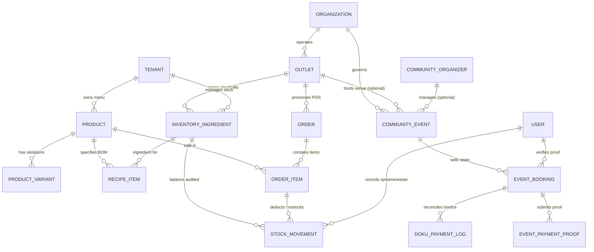
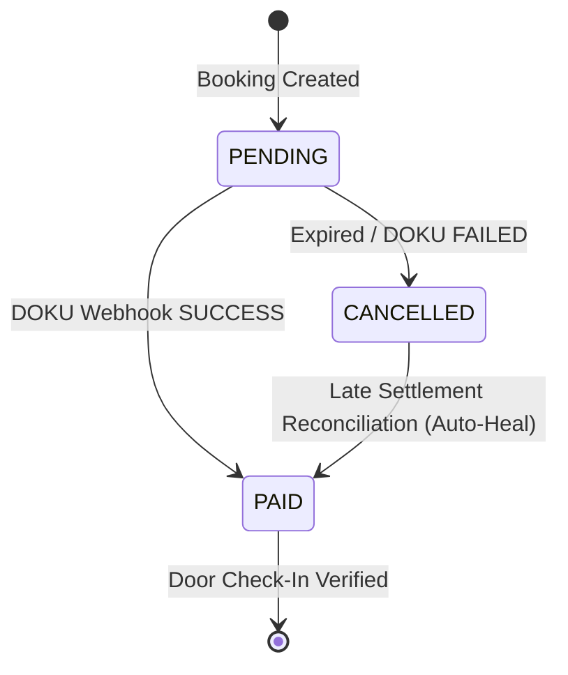

# DAGOENG — FORMAL PRISMA SCHEMA PROPOSAL (REVIEW & HARDENING)

**Status:** PROPOSAL ONLY — STRICTLY NON-DESTRUCTIVE / ZERO-DATABASE-MUTATION  
**Target Environment:** Neon Serverless PostgreSQL + Vercel Serverless Functions + Cloudflare R2  
**Baseline Verified:** 32 Existing Models in `prisma/schema.prisma`  
**Referenced Audits:** `DAGOENG_ETL_DRY_RUN_REPORT.md`, `src/types/event.ts`, `src/lib/events.ts`, `src/lib/event-capacity.ts`, `src/app/api/webhooks/doku/route.ts`  
**Revision:** Hardened Specification v2.0 (Post-Review & Codebase Truth Verification)  
**Date:** October 2026  

---

## 1. EXECUTIVE SUMMARY & ZERO-MUTATION DECLARATION

This document represents the formal schema specification and data migration proposal for transitioning Dago Creative Hub & Coffee Lab (`DagoEng`) from local JSON file persistence to a production-grade Neon PostgreSQL database on Vercel.

### Strict Non-Destructive Boundaries Maintained:
- **Zero Schema Mutation**: `prisma/schema.prisma` is completely unmodified.
- **Zero Database Operations**: No `prisma migrate dev`, `prisma migrate deploy`, `prisma db push`, `db seed`, or table resets have been executed.
- **Zero Code or Data Mutation**: `data/events.json`, `data/event_bookings.json`, `data/organizers.json`, and payment proofs remain 100% untouched.
- **Zero Cloud Resource Provisioning**: No external databases, storage buckets, or cloud API keys have been created or modified.
- **Zero PII / Secret Exposure**: All customer emails, phone numbers, tokens, and cryptographic secrets are masked or abstracted.

---

## 2. AUDIT TEMUAN TERVERIFIKASI DARI BASIS KODE AKTUAL

Investigasi mendalam terhadap kode sumber dan data lokal menghasilkan temuan faktual berikut:

### 2.1 Kompatibilitas ID Aktual vs ID Legacy
1. **Event Bookings (`data/event_bookings.json`)**:
   - `id`: Berformat `tkt-<timestamp>-<hash>` atau `tkt-latte-001` (misal: `tkt-1793179787698-cnwy9`, `tkt-latte-001`).
   - `ticketCode`: Berformat referensi tiket publik `DAGO-EVT-<angka>` (misal: `DAGO-EVT-72676`, `DAGO-EVT-77491`).
   - `guestToken`: Token privat acak (48 hex karakter) untuk tautan tiket mandiri (`/events/tickets/[token]`).
   - *Koreksi Kritis*: Draf proposal sebelumnya keliru menyebut `DAGO-EVT-*` sebagai `id`. Pada kode aktual, `id` adalah `tkt-*` (Primary Key internal), sedangkan `ticketCode` adalah `DAGO-EVT-*` (Kode Unik publik). Keduanya berjenis string dan harus dipertahankan.
2. **Community Events (`data/events.json`)**:
   - `id`: Berformat `evt-<slug>` atau `evt-<timestamp>-<hash>` (misal: `evt-latte-art-2026`, `evt-sunny-go-happy-hours`, `evt-1793173055748-1ujzs`).
3. **Organizers (`data/organizers.json`)**:
   - `id`: Berformat `org-comm-<name>` atau `org-<slug>` (misal: `org-comm-barista`, `org-panji-sakti-fc`, `org-comm-mvrh7q7b-cosk`).
4. **Primary Key Postgres**:
   - Seluruh model PostgreSQL harus menggunakan `id String @id @default(uuid())`. Tipe data string PostgreSQL (`VARCHAR`/`TEXT`) sepenuhnya kompatibel menerima ID legacy (`evt-*`, `tkt-*`, `org-*`) saat migrasi ETL, sekaligus mendukung pembuatan UUID otomatis untuk data transaksi baru pasca-migrasi.

### 2.2 Status Enum Aktual (Sesuai `src/types/event.ts`)
Draf proposal v1 menggunakan enum generik. Berikut adalah enum aktual yang benar-benar digunakan oleh sistem frontend dan API:
- **`EventStatus`**: `PENDING`, `APPROVED`, `REVISION_REQUESTED`, `REJECTED`, `ARCHIVED`. (Bukan `DRAFT`, `PUBLISHED`, dll).
- **`TicketPaymentStatus`**: `PAID`, `PENDING`, `CANCELLED`, `EXPIRED`.
- **`AttendeeCheckInStatus`**: `REGISTERED`, `PARTIALLY_CHECKED_IN`, `CHECKED_IN`.
- **`TicketPaymentMethod`**: `FREE`, `QRIS`, `CASH`, `TRANSFER`, `DOKU_CHECKOUT`, `MANUAL_TRANSFER`.

### 2.3 Kapasitas, Ketersediaan Tiket, dan Status Konfirmasi Fisik
Berdasarkan `src/lib/event-capacity.ts` dan `src/lib/events.ts`:
1. `maxCapacity` pada model event bersifat **opsional (`number?`)**.
2. `availableSeats` **TIDAK PERNAH DISIMPAN** di file JSON. Ketersediaan dihitung saat runtime (`ticketsRemaining = max(0, totalCapacity - ticketsReserved)`).
3. **Asumsi Kapasitas 50 Adalah Estimasi Belum Terkonfirmasi**:
   - Pada `src/lib/event-capacity.ts`, hanya ruang rapat coworking (Seminyak: 6, Ubud: 12) yang memiliki spesifikasi resmi (`COWORKING_FACILITY_SPEC`).
   - Venue publik (Main Hall, Amphitheater, dll.) yang tidak memiliki angka eksplisit diberi label `UNCONFIRMED_ESTIMATE` dengan fallback 50.
   - *Koreksi*: Nilai 50 untuk event legacy `evt-latte-art-2026` dan `evt-community-cleanup-2026` **bukan nilai yang disetujui**, melainkan data yang belum lengkap (`maxCapacity: NULL`, `isCapacityConfirmed: false`).
4. **Perhitungan Kuota Aktif**:
   - Booking berstatus `PAID` dan `PENDING` (yang belum lewat batas waktu `expiresAt`) **menahan kuota tiket**.
   - Booking berstatus `CANCELLED` dan `EXPIRED` **tidak menahan kuota**.
   - Check-in (`checkedInQty`) tidak mempengaruhi sisa kuota, melainkan mencatat kehadiran fisik pada hari-H.

### 2.4 Organizer, Hak Akses Publik, dan Multi-Tenant Scoping
1. **Penyelenggara Terverifikasi vs Publik**:
   - Dari 16 event di `data/events.json`, 10 event memiliki `organizerEmail` yang cocok dengan mitra resmi di `data/organizers.json`.
   - 6 event diajukan oleh masyarakat umum melalui formulir publik (`POST /api/events`).
2. **Pencegahan Celah Keamanan (Zero Public Edit Privilege)**:
   - Pengaju event publik **tidak memiliki akses edit atau hapus** setelah mengirimkan form.
   - Pengeditan, persetujuan (`APPROVED`), dan revisi (`REVISION_REQUESTED`) hanya dapat dilakukan oleh kurator platform melalui portal internal `/events-admin` yang dilindungi autentikasi sesi admin.
   - Relasi `organizerId` pada `CommunityEvent` harus dibuat opsional (`String?`), sedangkan `organizerEmail` tetap wajib.
3. **Scoping Organisasi**:
   - `Organization` (`organizations`): Platform pusat (Dago Creative Hub).
   - `Outlet` (`outlets`): Cabang fisik (misal Singaraja, Renon). `CommunityEvent` dapat dihubungkan ke `outletId` opsional jika diadakan di outlet tertentu.
   - `Tenant` (`tenants`): Stan F&B mandiri penyewa hub (misal Kopi Senja, Dapur Mama).

### 2.5 DOKU Webhook & Ketahanan State Pembayaran
Berdasarkan `src/app/api/webhooks/doku/route.ts`:
1. **Validasi Signature**: HMAC-SHA256 signature diverifikasi menggunakan `clientId`, `requestId`, `requestTimestamp`, `requestTarget`, dan `secretKey`.
2. **Penanganan Out-of-Order / Late Settlement**:
   - Jika notifikasi `SUCCESS` tiba untuk booking yang sempat ditandai `CANCELLED` akibat timeout lokal, webhook melakukan **rekonsiliasi otomatis** (`CANCELLED -> PAID`), mencatat log rekonsiliasi, dan menerbitkan tiket secara sah.
3. **Idempotensi**:
   - Jika booking sudah berstatus `PAID`, sistem langsung merespons `200 ALREADY_PROCESSED` tanpa menduplikasi data atau kuota.
4. **Perlindungan Data Sensitif**:
   - Payload webhook yang dicatat ke database harus disanitasi: nomor kartu kredit, token otorisasi, atau CVV tidak boleh disimpan; hanya metadata invoice, ID transaksi DOKU, channel, status, dan signature yang dipertahankan.

### 2.6 Keamanan Bukti Transfer Manual
Berdasarkan `src/app/api/events/proofs/[filename]/route.ts`:
1. File bukti transfer bersifat **private dan terotentikasi**. Akses publik tanpa hak ditolak (HTTP 401/403).
2. Hanya dapat diakses oleh:
   - Admin platform dengan sesi aktif.
   - Pemilik tiket yang menyertakan query parameter token rahasianya: `?token=<guestToken>`.
3. Hash biner **SHA-256** dan path penyimpanan Cloudflare R2 (`storageKey`) wajib dicatat untuk audit forensik anti-pemalsuan struk transfer.

### 2.7 Multi-Outlet Inventory, BOM, dan Stock Movement
1. **Batasan Fisik Multi-Outlet**:
   - Stan F&B (`Tenant`) menjual produk di lokasi fisik (`Outlet`). Bahan baku fisik berada di outlet tertentu.
   - `InventoryIngredient` harus discoping berdasarkan kombinasi `(tenantId, outletId)` agar stok biji kopi di Cabang Singaraja tidak tercampur dengan Cabang Renon.
2. **Presisi Desimal & Konsistensi Unit**:
   - Bahan baku menggunakan unit bervariasi (`gram`, `ml`, `pcs`, `shot`).
   - Stok fisik harus bertipe `Decimal(12, 3)` (misal `18.500` gram, `250.000` ml) untuk menghindari kesalahan pembulatan pada takaran barista/dapur.
   - Biaya per unit dan harga menggunakan `Int` (rupiah utuh).
3. **Idempotensi Pengurangan Stok**:
   - Pengurangan stok otomatis dari pesanan kasir (`ORDER_CONSUMPTION`) harus memiliki constraint idempotensi unik pada `(orderItemId, ingredientId, movementType)` agar retry checkout POS tidak mengurangi stok berulang kali.
   - Pembatalan transaksi POS memicu pergerakan pembalik bertipe `ORDER_CANCEL_RESTOCK`.

---

## 3. DAFTAR KOREKSI TERHADAP PROPOSAL SEBELUMNYA

Berikut tabel perbaikan komparatif dari draf proposal awal ke proposal yang telah dikeraskan:

| Komponen | Draf Proposal Awal | Koreksi yang Dikeraskan (v2.0) | Dasar Faktual |
|---|---|---|---|
| **Primary Key Booking** | Diasumsikan `DAGO-EVT-*` | `id` adalah `tkt-*` (PK internal), `ticketCode` adalah `DAGO-EVT-*` (UK publik) | `data/event_bookings.json` |
| **Enum EventStatus** | `DRAFT`, `PUBLISHED`, dll. | `PENDING`, `APPROVED`, `REVISION_REQUESTED`, `REJECTED`, `ARCHIVED` | `src/types/event.ts` |
| **Enum PaymentStatus** | `UNPAID`, `REFUNDED`, dll. | `PAID`, `PENDING`, `CANCELLED`, `EXPIRED` | `src/types/event.ts` |
| **Enum CheckInStatus** | `PENDING`, `PARTIAL`, `COMPLETED` | `REGISTERED`, `PARTIALLY_CHECKED_IN`, `CHECKED_IN` | `src/types/event.ts` |
| **Kapasitas Legacy Event** | Dipaksakan default 50 | Tetap `NULL` dengan status `isCapacityConfirmed: false` (Open Decision) | `src/lib/event-capacity.ts` |
| **Penyimpanan Available Seats** | Kolom tersimpan `availableSeats` | Dihitung runtime + dicegah overselling via Transaksi Database Pessimistic Lock | `src/lib/events.ts` |
| **Scoping Bahan Baku (BOM)** | Hanya terhubung ke `tenantId` | Terhubung ke `tenantId` DAN `outletId` (Multi-outlet physical isolation) | `prisma/schema.prisma` (`Outlet`) |
| **Presisi Stok Bahan Baku** | Menggunakan `Float` | Menggunakan `Decimal(12, 3)` untuk mencegah floating point error | Standar akuntansi F&B |
| **Idempotensi Stok Order** | Belum ada constraint unik | Ditambahkan `@@unique([orderItemId, ingredientId, movementType])` | Mencegah race condition POS |

---

## 4. MODEL DAN RELASI YANG DIREKOMENDASIKAN (REVIEW ONLY)

```prisma
// -----------------------------------------------------------------------------
// 8. COMMUNITY EVENT MARKETPLACE & TICKETING (HARDENED SPECIFICATION)
// -----------------------------------------------------------------------------

enum EventStatus {
  PENDING
  APPROVED
  REVISION_REQUESTED
  REJECTED
  ARCHIVED
}

enum TicketPaymentStatus {
  PAID
  PENDING
  CANCELLED
  EXPIRED
}

enum AttendeeCheckInStatus {
  REGISTERED
  PARTIALLY_CHECKED_IN
  CHECKED_IN
}

enum TicketPaymentMethod {
  FREE
  QRIS
  CASH
  TRANSFER
  DOKU_CHECKOUT
  MANUAL_TRANSFER
}

model CommunityOrganizer {
  id          String   @id @default(uuid()) // Preserves "org-comm-*" legacy IDs
  name        String
  email       String   @unique
  phone       String?
  bio         String?
  avatarUrl   String?  @map("avatar_url")
  website     String?
  status      String   @default("ACTIVE") // "ACTIVE", "SUSPENDED"
  createdAt   DateTime @default(now()) @map("created_at")
  updatedAt   DateTime @updatedAt @map("updated_at")

  // Relationships
  events      CommunityEvent[]

  @@map("community_organizers")
}

model CommunityEvent {
  id                      String      @id @default(uuid()) // Preserves "evt-*" legacy IDs
  organizationId          String?     @map("organization_id") // Scoping multi-tenant platform
  outletId                String?     @map("outlet_id")       // Cabang fisik penyelenggara (opsional)
  organizerId             String?     @map("organizer_id")    // Relasi ke CommunityOrganizer terdaftar (opsional)
  title                   String
  slug                    String?     @unique
  description             String?     @db.Text
  category                String      // "WORKSHOP", "MEETUP", "CREATIVE", "COMMUNITY", "TECH", "SEMINAR", "OTHER"
  startDate               DateTime    @map("start_date")
  endDate                 DateTime    @map("end_date")
  location                String
  isPaid                  Boolean     @default(false) @map("is_paid")
  price                   Int         @default(0) // IDR (whole rupiah)
  maxCapacity             Int?        @map("max_capacity") // Nullable: tidak dipaksakan 50
  isCapacityConfirmed     Boolean     @default(false) @map("is_capacity_confirmed")
  maxTicketsPerBooking    Int         @default(5) @map("max_tickets_per_booking")
  status                  EventStatus @default(PENDING)
  posterUrl               String?     @map("poster_url")
  externalRegistrationUrl String?     @map("external_registration_url")
  organizerName           String      @map("organizer_name")
  organizerEmail          String      @map("organizer_email") // Wajib untuk korespondensi
  organizerPhone          String?     @map("organizer_phone")
  adminNotes              String?     @map("admin_notes") @db.Text
  rejectionReason         String?     @map("rejection_reason") @db.Text
  revisionNotes           String?     @map("revision_notes") @db.Text
  destinationBankId       String?     @map("destination_bank_id")
  organizerFeePercent     Float       @default(80.0) @map("organizer_fee_percent")
  customPlatformFeePercent Float?     @map("custom_platform_fee_percent")
  payoutStatus            String      @default("UNQUALIFIED") @map("payout_status")
  createdAt               DateTime    @default(now()) @map("created_at")
  updatedAt               DateTime    @updatedAt @map("updated_at")

  // Relationships
  organization            Organization?       @relation(fields: [organizationId], references: [id], onDelete: SetNull)
  outlet                  Outlet?             @relation(fields: [outletId], references: [id], onDelete: SetNull)
  organizer               CommunityOrganizer? @relation(fields: [organizerId], references: [id], onDelete: SetNull)
  bookings                EventBooking[]

  @@index([organizationId])
  @@index([organizerId])
  @@index([status, startDate])
  @@map("community_events")
}

model EventBooking {
  id                    String                @id @default(uuid()) // Preserves "tkt-*" legacy IDs
  ticketCode            String                @unique @map("ticket_code") // Preserves "DAGO-EVT-*" unique reference
  eventId               String                @map("event_id")
  guestName             String                @map("guest_name")
  guestEmail            String                @map("guest_email")
  guestPhone            String?               @map("guest_phone")
  institution           String?
  ticketCount           Int                   @default(1) @map("ticket_count")
  checkedInQty          Int                   @default(0) @map("checked_in_qty")
  unitPrice             Int                   @map("unit_price") // IDR
  totalPrice            Int                   @map("total_price") // IDR
  platformFeePercent    Float                 @default(20.0) @map("platform_fee_percent")
  platformFeeAmount     Int                   @default(0) @map("platform_fee_amount")
  organizerRevenueAmount Int                  @default(0) @map("organizer_revenue_amount")
  paymentMethod         TicketPaymentMethod   @map("payment_method")
  paymentStatus         TicketPaymentStatus   @default(PENDING) @map("payment_status")
  checkInStatus         AttendeeCheckInStatus @default(REGISTERED) @map("check_in_status")
  guestToken            String                @unique @map("guest_token") // 48-char cryptographic token
  dokuInvoiceNumber     String?               @unique @map("doku_invoice_number")
  dokuPaymentUrl        String?               @map("doku_payment_url")
  paidAt                DateTime?             @map("paid_at")
  expiresAt             DateTime?             @map("expires_at")
  checkInTime           DateTime?             @map("check_in_time")
  paymentVerifiedAt     DateTime?             @map("payment_verified_at")
  paymentVerifiedBy     String?               @map("payment_verified_by") // userId
  paymentRejectionReason String?              @map("payment_rejection_reason")
  createdAt             DateTime              @default(now()) @map("created_at")
  updatedAt             DateTime              @updatedAt @map("updated_at")

  // Relationships
  event                 CommunityEvent        @relation(fields: [eventId], references: [id], onDelete: Cascade)
  verifier              User?                 @relation("BookingVerifier", fields: [paymentVerifiedBy], references: [id], onDelete: SetNull)
  paymentProofs         EventPaymentProof[]
  dokuLogs              DokuPaymentLog[]

  @@index([eventId])
  @@index([guestEmail])
  @@index([guestToken])
  @@index([paymentStatus, expiresAt])
  @@map("event_bookings")
}

model EventPaymentProof {
  id               String       @id @default(uuid())
  bookingId        String       @map("booking_id")
  storageKey       String       @map("storage_key")       // Path Cloudflare R2 (e.g. "proofs/booking-id/file.png")
  originalFilename String       @map("original_filename")
  mimeType         String       @map("mime_type")         // "image/png", "image/jpeg", "application/pdf"
  fileSize         Int          @map("file_size")         // Bytes
  sha256Hash       String       @map("sha256_hash")       // Cryptographic tamper-evidence
  uploaderIp       String?      @map("uploader_ip")
  status           String       @default("PENDING")       // "PENDING", "VERIFIED", "REJECTED", "ARCHIVED"
  rejectionReason  String?      @map("rejection_reason")
  createdAt        DateTime     @default(now()) @map("created_at")
  updatedAt        DateTime     @updatedAt @map("updated_at")

  // Relationships
  booking          EventBooking @relation(fields: [bookingId], references: [id], onDelete: Cascade)

  @@index([bookingId])
  @@index([sha256Hash])
  @@map("event_payment_proofs")
}

model DokuPaymentLog {
  id               String       @id @default(uuid())
  bookingId        String?      @map("booking_id")
  requestId        String       @unique @map("request_id") // DOKU header Request-Id untuk idempotensi total
  invoiceNumber    String       @map("invoice_number")
  paymentChannel   String?      @map("payment_channel")    // "VIRTUAL_ACCOUNT_BCA", "QRIS"
  dokuPaymentId    String?      @map("doku_payment_id")
  amount           Int          @map("amount")
  signature        String       @map("signature")
  isSignatureValid Boolean      @default(false) @map("is_signature_valid")
  sanitizedPayload Json         @map("sanitized_payload")  // Payload tanpa CVV / Card Token
  ipAddress        String?      @map("ip_address")
  status           String       @map("status")             // "SUCCESS", "FAILED", "EXPIRED", "RECONCILED"
  processedAt      DateTime     @default(now()) @map("processed_at")

  // Relationships
  booking          EventBooking? @relation(fields: [bookingId], references: [id], onDelete: SetNull)

  @@index([invoiceNumber])
  @@index([bookingId])
  @@map("doku_payment_logs")
}

// -----------------------------------------------------------------------------
// 9. MULTI-OUTLET INVENTORY, RECIPE (BOM) & STOCK AUDIT (HARDENED)
// -----------------------------------------------------------------------------

enum StockMovementType {
  PURCHASE_RECEIPT      // Penambahan stok dari supplier
  ORDER_CONSUMPTION     // Pengurangan otomatis saat order POS checkout
  ORDER_CANCEL_RESTOCK  // Pengembalian stok otomatis saat order dibatalkan
  WASTE_SPOILED         // Bahan basi / tumpah / kedaluwarsa
  OPNAME_ADJUSTMENT     // Penyesuaian fisik stok opname
  RETURN_TO_VENDOR      // Retur bahan cacat ke supplier
}

model InventoryIngredient {
  id           String          @id @default(uuid())
  tenantId     String          @map("tenant_id")
  outletId     String          @map("outlet_id") // Isolasi fisik multi-outlet
  name         String
  sku          String?         @map("sku")
  unit         String          // "gram", "ml", "pcs", "shot"
  currentStock Decimal         @default(0.0) @db.Decimal(12, 3) @map("current_stock")
  minimumStock Decimal         @default(10.0) @db.Decimal(12, 3) @map("minimum_stock")
  costPerUnit  Int             @default(0) @map("cost_per_unit") // IDR per unit
  isActive     Boolean         @default(true) @map("is_active")
  createdAt    DateTime        @default(now()) @map("created_at")
  updatedAt    DateTime        @updatedAt @map("updated_at")

  // Relationships
  tenant       Tenant          @relation(fields: [tenantId], references: [id], onDelete: Cascade)
  outlet       Outlet          @relation(fields: [outletId], references: [id], onDelete: Cascade)
  recipeItems  RecipeItem[]
  movements    StockMovement[]

  @@unique([tenantId, outletId, name])
  @@index([tenantId, outletId])
  @@map("inventory_ingredients")
}

model RecipeItem {
  id               String              @id @default(uuid())
  productId        String              @map("product_id")
  variantId        String?             @map("variant_id")
  ingredientId     String              @map("ingredient_id")
  quantityRequired Decimal             @db.Decimal(12, 3) @map("quantity_required")
  notes            String?
  createdAt        DateTime            @default(now()) @map("created_at")

  // Relationships
  product          Product             @relation(fields: [productId], references: [id], onDelete: Cascade)
  variant          ProductVariant?     @relation(fields: [variantId], references: [id], onDelete: Cascade)
  ingredient       InventoryIngredient @relation(fields: [ingredientId], references: [id], onDelete: Restrict)

  @@unique([productId, variantId, ingredientId])
  @@index([productId])
  @@index([ingredientId])
  @@map("recipe_items")
}

model StockMovement {
  id             String            @id @default(uuid())
  ingredientId   String            @map("ingredient_id")
  orderItemId    String?           @map("order_item_id")
  performedById  String?           @map("performed_by_id")
  movementType   StockMovementType @map("movement_type")
  quantityDelta  Decimal           @db.Decimal(12, 3) @map("quantity_delta") // Negatif untuk konsumsi, positif untuk receipt
  balanceBefore  Decimal           @db.Decimal(12, 3) @map("balance_before")
  balanceAfter   Decimal           @db.Decimal(12, 3) @map("balance_after")
  unitCost       Int?              @map("unit_cost")
  referenceNotes String?           @map("reference_notes")
  createdAt      DateTime          @default(now()) @map("created_at")

  // Relationships
  ingredient     InventoryIngredient @relation(fields: [ingredientId], references: [id], onDelete: Cascade)
  orderItem      OrderItem?          @relation(fields: [orderItemId], references: [id], onDelete: SetNull)
  performedBy    User?               @relation(fields: [performedById], references: [id], onDelete: SetNull)

  // Mencegah duplicate stock deduction dari POS checkout
  @@unique([orderItemId, ingredientId, movementType])
  @@index([ingredientId, createdAt])
  @@map("stock_movements")
}
```

---

## 5. DIAGRAM ENTITY-RELATIONSHIP (MERMAID)



---

## 6. PREVENSI OVERSELLING PADA TRANSAKSI BERSAMAAN (CONCURRENCY)

Pada penjualan tiket publik bertrafik tinggi, menghitung sisa kuota tanpa mekanisme konkurensi di tingkat database dapat menimbulkan **overselling** (kuota terlampaui karena dua transaksi membaca sisa kursi yang sama secara simultan).

### Rekomendasi Arsitektur: Pessimistic Row Locking (`SELECT FOR UPDATE`)
Alih-alih menyimpan kolom `availableSeats` yang rentan terdesinkronisasi, ketersediaan tiket dikendalikan di dalam transaksi database atomik PostgreSQL:

```typescript
// Atomicity & Concurrency Guard pada /api/events/bookings/create
await prisma.$transaction(async (tx) => {
  // 1. Kunci baris event secara eksklusif selama transaksi berlangsung
  const [event] = await tx.$queryRaw<Array<{ id: string; max_capacity: number | null }>>`
    SELECT id, max_capacity FROM community_events 
    WHERE id = ${eventId} 
    FOR UPDATE
  `;

  if (!event) throw new Error("EVENT_NOT_FOUND");

  // 2. Jika kapasitas ditentukan, hitung tiket yang sedang menahan kuota secara real-time
  if (event.max_capacity !== null) {
    const reservedAgg = await tx.$queryRaw<Array<{ total_reserved: number }>>`
      SELECT COALESCE(SUM(ticket_count), 0)::int AS total_reserved
      FROM event_bookings
      WHERE event_id = ${eventId}
        AND (
          payment_status = 'PAID' 
          OR (payment_status = 'PENDING' AND (expires_at IS NULL OR expires_at > NOW()))
        )
    `;

    const totalReserved = reservedAgg[0]?.total_reserved || 0;
    if (totalReserved + requestedTicketCount > event.max_capacity) {
      throw new Error("QUOTA_EXCEEDED"); // Transaksi dibatalkan secara atomik
    }
  }

  // 3. Terbitkan booking dengan aman
  return tx.eventBooking.create({
    data: {
      id: generateTicketId(),        // "tkt-..."
      ticketCode: generateTicketCode(), // "DAGO-EVT-..."
      eventId,
      guestToken: generateSecureToken(),
      ticketCount: requestedTicketCount,
      paymentStatus: 'PENDING',
      expiresAt: calculateExpiry(15), // 15 menit kuota hold
      // ... data lainnya
    }
  });
});
```

**Keunggulan Metode Ini**:
1. **Zero Split-Brain**: Tidak ada redundansi antara kolom `available_seats` dan data aktual transaksi di `event_bookings`.
2. **Strict Concurrency**: Permintaan pembelian tiket yang tiba bersamaan akan diantrekan oleh PostgreSQL pada baris event tersebut, memastikan kuota tidak akan pernah terlampaui.
3. **Auto-Release**: Jika booking `PENDING` melewati batas waktu `expiresAt`, kuotanya otomatis terbuka bagi pembeli lain tanpa memerlukan cron-job pengembalian kolom angka.

---

## 7. RENCANA BACKFILL DATA LEGACY & INTEGRITAS TRANSAKSI

### 7.1 Backfill Kriptografis `guestToken` (3 Booking)
Tiga data riwayat transaksi belum memiliki `guestToken`:
- `tkt-1793006245099-bpw9k` (`ticketCode: DAGO-EVT-48246`, Status: `CANCELLED`)
- `tkt-latte-001` (`ticketCode: DAGO-EVT-77491`, Status: `PAID`, Pemilik: `budi.santoso@gmail.com`)
- `tkt-latte-002` (`ticketCode: DAGO-EVT-88219`, Status: `PAID`, Pemilik: `citra.lestari@gmail.com`)

**Strategi**:
1. Token di-generate menggunakan `crypto.randomBytes(24).toString('hex')` (48 karakter hex) selama proses ETL.
2. Karena kolom `guestToken` di-set `UNIQUE NOT NULL`, token ter-backfill mencegah error integritas database.
3. Pemilik tiket berbayar (`tkt-latte-001` dan `tkt-latte-002`) dapat mengakses kembali tiket mereka melalui formulir pemulihan tiket mandiri (`/events/recover-ticket`) menggunakan kombinasi kode invoice dan email terverifikasi.

### 7.2 Penanganan 2 Event Legacy Tanpa Kuota
- `evt-latte-art-2026`: `maxCapacity: NULL`
- `evt-community-cleanup-2026`: `maxCapacity: NULL`

**Strategi**:
- Nilai di database dimasukkan sebagai `maxCapacity: NULL` dan `isCapacityConfirmed: false`.
- Event tidak boleh dipaksa 50 di database. Admin kurator hub wajib melakukan verifikasi fisik kapasitas ruangan sebelum mengaktifkan kuota penjualan.

### 7.3 Penanganan 6 Event Penyelenggara Publik (Unregistered)
- Event publik dimasukkan dengan `organizerId: NULL` dan `organizerEmail: "<email-pengaju>"`.
- Integritas referensial foreign key tetap terjaga karena `organizerId` bertipe nullable.
- Jika di masa mendatang penyelenggara mendaftar akun resmi dengan email yang sama, script asosiasi dapat menghubungkan `organizerId` secara otomatis.

---

## 8. DOKU WEBHOOK IDEMPOTENSI & STATE MACHINE



### Aturan Ketahanan Webhook:
1. **Idempotensi via Header `Request-Id`**:
   Setiap panggilan webhook dari DOKU menyertakan header unik `Request-Id`. Jika log dengan `requestId` tersebut sudah tercatat, webhook langsung mengembalikan `HTTP 200 OK` tanpa mutasi status ulang.
2. **Rekonsiliasi Late-Settlement**:
   Jika pelanggan membayar tepat pada detik timeout dan sistem lokal sempat menandai `CANCELLED`, webhook DOKU berstatus `SUCCESS` akan merekonsiliasi booking kembali menjadi `PAID`, menerbitkan notifikasi ke admin, dan menandai `reconciledFromCancelled: true`.
3. **Data Protection**:
   `DokuPaymentLog.sanitizedPayload` mengecualikan segala bentuk instrumen pembayaran sensitif, hanya menyimpan nomor invoice, amount, channel, timestamp, dan status.

---

## 9. STRATEGI BASELINE MIGRATION PADA DATABASE STAGING KOSONG

Karena direktori `prisma/migrations` saat ini belum ada, urutan penerapan ke Neon PostgreSQL staging harus terpisah secara tegas antara **generasi skema struktur** dan **migrasi data (ETL)**:

```
[Tahap 0: Review Proposal & Persetujuan Pemilik Proyek]
                       ↓
[Tahap 1: Provisioning Neon PostgreSQL Staging (DB Kosong)]
                       ↓
[Tahap 2: Generasi Baseline SQL via prisma migrate dev --create-only]
                       ↓
[Tahap 3: Review Manual File migration.sql yang Dihasilkan]
                       ↓
[Tahap 4: Eksekusi prisma migrate deploy pada DB Staging]
                       ↓
[Tahap 5: Eksekusi Non-Destruktif Data ETL (scripts/migrate-json-to-postgres.ts)]
                       ↓
[Tahap 6: Verifikasi Rekonsiliasi Row Count, Foreign Key, & Hash Bukti Transfer]
```

### Prosedur Rollback:
- Jika terjadi kegagalan pada Tahap 4 atau 5, database staging dapat di-drop dan di-recreate secara bersih dalam hitungan detik karena file JSON sumber di disk tidak pernah dimodifikasi.
- Tidak ada risiko kehilangan data karena lingkungan produksi belum terhubung.

---

## 10. RISIKO DAN KEPUTUSAN BISNIS YANG BELUM DITENTUKAN

| # | Item Keputusan | Kondisi Aktual | Pilihan yang Tersedia | Dampak / Risiko |
|---|---|---|---|---|
| 1 | **Kapasitas Fisik 2 Event Legacy** | `evt-latte-art-2026` & `evt-community-cleanup-2026` bernilai `undefined` | **Opsi A**: Tetapkan `NULL` (unlimited/tutup penjualan).<br>**Opsi B**: Konfirmasi manual kuota fisik ruangan ke pengelola gedung. | Memaksakan 50 berisiko overselling jika ruangan hanya muat 30 orang. |
| 2 | **Kebijakan Payout Organizer** | `payoutStatus` di `src/types/event.ts` memiliki 8 status kompleks | **Opsi A**: Sederhanakan menjadi `UNQUALIFIED`, `PENDING`, `PAID`.<br>**Opsi B**: Implementasikan state machine lengkap sesuai interface `OrganizerPayoutStatus`. | Opsi B membutuhkan pembuatan tabel `payout_records` tersendiri. |
| 3 | **Retensi Bukti Pembayaran** | Bukti transfer lokal di `data/proofs/` berformat PNG/JPG | **Opsi A**: Simpan di private R2 dengan soft-delete 90 hari.<br>**Opsi B**: Simpan permanen untuk audit pajak/keuangan tahunan. | Opsi B menambah biaya storage jangka panjang (namun sangat kecil untuk R2). |
| 4 | **Presisi Pembagian Hasil Platform** | `platformFeePercent` di JSON bervariasi (10% hingga 20%) | Simpan persentase historis pada masing-masing baris `event_bookings` saat transaksi terjadi. | Terlindungi dari perubahan tarif platform di masa depan. |

---

## 11. RENCANA PENGUJIAN DAN REKONSILIASI

Sebelum data dinyatakan siap untuk staging Vercel, serangkaian pengujian terotomatisasi wajib dijalankan:
1. **ETL Dry-Run Validation (`tests/etl-data-validation.test.ts`)**:
   - Memastikan 16 event, 8 booking, dan 9 organizer berhasil divalidasi skemanya tanpa error.
   - Memastikan SHA-256 hash bukti transfer cocok dengan file fisik di `data/proofs/`.
2. **Type-Check Project Integrity (`npm run type-check`)**:
   - Memastikan penambahan model tidak merusak tipe TypeScript yang sudah ada.
3. **Idempotency Simulation Test**:
   - Mensimulasikan pengiriman webhook DOKU berulang kali dengan `Request-Id` yang sama untuk memastikan tidak terjadi duplikasi saldo atau tiket.
4. **Stress Testing Concurrency Quota**:
   - Menjalankan 50 request pembelian tiket bersamaan pada event berkapasitas 5 kursi untuk memverifikasi bahwa `FOR UPDATE` lock menolak tepat 45 request dengan `QUOTA_EXCEEDED`.

---

## 12. CHECKLIST PERSETUJUAN SEBELUM IMPLEMENTASI

Dokumen ini disusun untuk direview oleh pemilik proyek. Mohon berikan keputusan eksplisit untuk poin-poin berikut sebelum eksekusi teknis dimulai:

- [ ] **Persetujuan 1**: Menyetujui nama model dan struktur relasi Event Marketplace (`CommunityOrganizer`, `CommunityEvent`, `EventBooking`, `EventPaymentProof`, `DokuPaymentLog`).
- [ ] **Persetujuan 2**: Menyetujui struktur Multi-Outlet Inventory & BOM (`InventoryIngredient` dengan scoping `tenantId + outletId`, `RecipeItem`, `StockMovement`).
- [ ] **Persetujuan 3**: Menyetujui bahwa kapasitas untuk `evt-latte-art-2026` dan `evt-community-cleanup-2026` dibiarkan `NULL` (tidak dipaksa 50) hingga diverifikasi pengelola gedung.
- [ ] **Persetujuan 4**: Menyetujui backfill token kriptografis 48-hex untuk 3 booking warisan (`DAGO-EVT-48246`, `DAGO-EVT-77491`, `DAGO-EVT-88219`).
- [ ] **Persetujuan 5**: Menyetujui penggunaan Pessimistic Lock (`SELECT FOR UPDATE`) pada PostgreSQL untuk mencegah overselling tiket.
- [ ] **Persetujuan 6**: Memberikan izin tertulis untuk memodifikasi `prisma/schema.prisma` dan membuat file migration baseline setelah database staging Neon disediakan.

---
*Laporan ini dipersiapkan secara ketat dalam mode review non-destruktif. Tidak ada skema, database, data JSON, atau file kode aplikasi yang diubah selama proses ini.*
