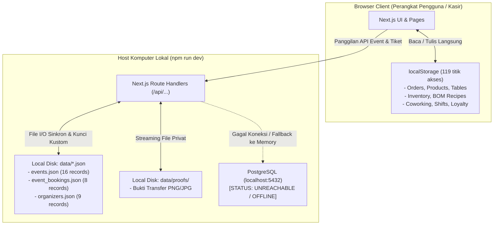
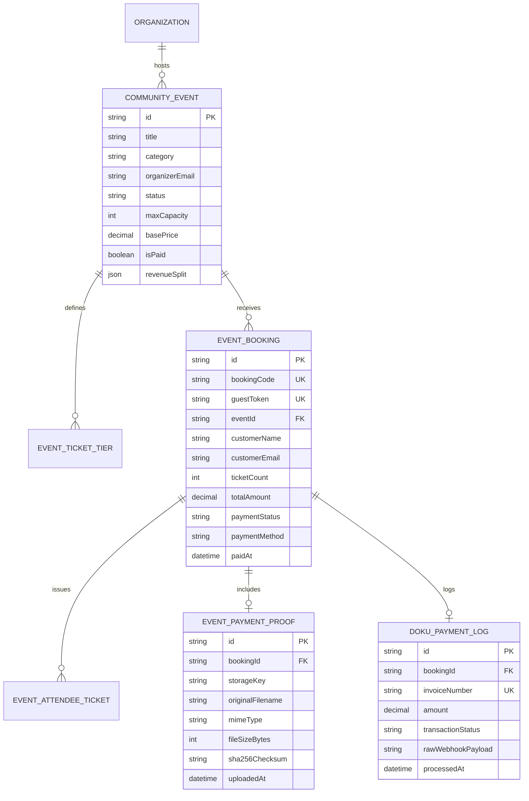
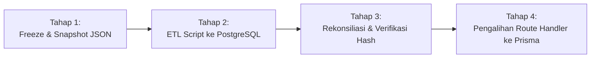

# DAGOENG — PUBLIC PRODUCTION READINESS BLUEPRINT
**Target Arsitektur**: Next.js (App Router) + Vercel + PostgreSQL (Managed Cloud) + Private Object Storage (S3 / Cloudflare R2)  
**Dokumen Status**: Review Only | Architecture Blueprint | Zero Execution  
**Tanggal Audit Baseline**: 29 Oktober 2026  
**Penulis**: Senior Fullstack & Security Architecture Review Team

---

## 1. EXECUTIVE SUMMARY

### 1.1 Status Kesiapan Rilis
Berdasarkan audit teknis menyeluruh secara *read-only* terhadap repositori `DagoEng F&B Management`:

| Target Lingkungan | Status Kelayakan | Ringkasan Kesimpulan |
| :--- | :---: | :--- |
| **Demo Lokal (30 Okt 2026)** | **GO (LAYAK)** | Server pengembangan (`npm run dev`) berfungsi normal. Seluruh skenario RBAC, alur POS kasir, booking tiket, penerbitan QR token, dan perlindungan bukti transfer privat telah terverifikasi lulus 100% (52 test files, 569 unit/integration tests lulus). |
| **Produksi Publik (Vercel)** | **NO-GO (BELUM LAYAK)** | **Terdapat celah arsitektur fundamental yang menghalangi deployment produksi publik multi-tenant**: data operasional F&B dan coworking masih berada di `localStorage` per peramban, data Event Marketplace disimpan di berkas `data/*.json` lokal, bukti transfer diunggah ke *local disk*, dan database PostgreSQL belum terkoneksi. |

### 1.2 Gap Arsitektur Utama Menuju Produksi Publik
1. **Penyimpanan Ephemeral di Lingkungan Serverless (Vercel)**:
   Arsitektur Vercel berbasis fungsi *serverless/edge* yang bersifat *stateless* dan *ephemeral*. Modul Event Marketplace yang saat ini membaca/menulis ke `data/events.json`, `data/event_bookings.json`, dan direktori `data/proofs/` akan kehilangan seluruh data baru dan unggahan bukti transfer saat *instance container* Vercel melakukan *cold start*, *recycle*, atau *redeploy*.
2. **Fragmentasi Data di Peramban Pengguna (`localStorage`)**:
   Modul inti F&B POS, Inventaris Bahan Baku/Resep (BOM), Coworking Spaces & Memberships, Shift Kasir, Meja & Reservasi, serta Loyalty Points berjalan sepenuhnya di atas React Context yang menyinkronkan data ke `localStorage` masing-masing peramban (119 lokasi pemanggilan). Data tidak tersentralisasi lintas kasir, perangkat, maupun tenant.
3. **Database PostgreSQL & Skema Prisma Belum Tersambung**:
   Meskipun Prisma ORM terpasang (`@prisma/client` 5.22.0) dengan 32 model terdefinisi di `prisma/schema.prisma`, koneksi database `localhost:5432` berstatus **UNREACHABLE**, direktori `prisma/migrations` **tidak ada**, dan kode aplikasi operasional hanya memanggil Prisma pada 4 berkas (terkait Session dan User). Modul Event Marketplace dan Inventory/BOM bahkan belum memiliki definisi model sama sekali di dalam skema Prisma.
4. **Kesiapan Gateway Pembayaran DOKU**:
   Integrasi DOKU telah memiliki verifikasi tanda tangan HMAC-SHA256 yang aman pada webhook (`/api/webhooks/doku`). Namun, konfigurasi saat ini masih mengarah ke *sandbox environment* (`https://api-sandbox.doku.com`) dengan *fallback test credentials*. Transisi ke akun *live production* membutuhkan kredensial resmi, penyesuaian domain webhook HTTPS publik, dan pencatatan audit log transaksi persisten.

---

## 2. BASELINE GIT DAN INTEGRITAS DATA

### 2.1 Kondisi Repositori Terverifikasi
* **Branch**: `main` (sinkron dengan `origin/main`).
* **Runtime & Toolchain**:
  - Node.js: `v22.11.0`
  - npm: `10.9.0`
  - Next.js: `^14.2.18` (terpasang `14.2.35`)
  - Prisma CLI & Client: `^5.22.0`
  - TypeScript: `^5.6.3`
* **Status Working Tree**:
  - *Tracked Modified Files*:
    - `data/event_bookings.json` (Sanitasi URL bukti privat)
    - `data/event_settings.json` (Konfigurasi bank transfer dan kebijakan verifikasi)
    - `src/app/(dashboard)/events-admin/page.tsx` (Perlindungan tampilan admin event)
    - `src/app/api/auth/login/route.ts` (Partisi demo credentials & pemblokiran eskalasi)
    - `src/app/api/events/bookings/[id]/route.ts` (Validasi RBAC update status)
    - `src/app/api/events/tickets/[token]/route.ts` (Penyimpanan bukti privat & validasi magic bytes)
    - `src/app/api/webhooks/doku/simulate/route.ts` (Pemblokiran simulator di production)
    - `src/app/checkout-link-v2/[token]/page.tsx` (Integrasi checkout transfer aman)
    - `src/lib/data-storage.ts` (Helper penyimpanan privat)
    - `src/lib/server-auth.ts` (Validasi otorisasi server-side)
    - `tests/doku-payment.test.ts` (Suite uji HMAC & webhook)
    - `tests/login-security-and-data-integrity.test.ts` (Suite uji otorisasi login)
  - *Untracked Verified Artifacts*:
    - `data/backup_legacy_proofs/` (Cadangan utuh bukti lama)
    - `data/event_bookings.backup.json` (Cadangan data transaksi)
    - `data/proofs/` (Direktori penyimpanan privat bukti bayar)
    - `src/app/api/events/proofs/` (Endpoint privat berotentikasi)
    - `src/lib/file-security.ts` (Validasi magic bytes & sanitasi path traversal)
    - `tests/final-demo-readiness.test.ts` (Suite validasi skenario demo)
    - `tests/payment-proof-security.test.ts` (Suite audit RBAC & anti-IDOR)

### 2.2 Integritas Bukti Pembayaran (Zero Data Loss)
Seluruh berkas bukti transfer lama telah dipindahkan dari folder publik (`public/images/events/proofs/`) ke penyimpanan privat (`data/proofs/`) dan dicadangkan ke `data/backup_legacy_proofs/`. Integritas hash SHA-256 terbukti identik:
1. `proof-dago-evt-51628-1793179519555.png` (588.864 bytes)  
   SHA-256: `05A9D413298885A99B7993E08809019FD464F62C0F75751C776EF7D6E40C3D24`
2. `proof-dago-evt-72676-1793179816938.png` (143.997 bytes)  
   SHA-256: `BC37D23026012DE4FDAD3B5DA743A3682FA007DFEEC2F790CC6081FAF4EFFA47`

Folder publik `public/images/events/proofs/` telah ditiadakan (`Test-Path` bernilai `False`), sehingga kebocoran URL statis tertutup total.

---

## 3. ARSITEKTUR SAAT INI VERSUS TARGET PRODUKSI

### 3.1 Diagram Arsitektur Saat Ini (Local Demo State)


### 3.2 Diagram Arsitektur Target Produksi (Vercel + Cloud PostgreSQL + Object Storage)
```mermaid
flowchart TD
    subgraph VercelEdge ["Vercel Cloud Platform (Serverless & Edge)"]
        EdgeApp["Next.js App Router (Stateless SSR/SSG/ISR)"]
        ServerlessAPI["Next.js API Route Handlers (Serverless Functions)"]
        AuthMiddleware["Server-Side Auth & Session Guard (JWT/Cookies)"]
        EdgeApp --> AuthMiddleware --> ServerlessAPI
    end

    subgraph ManagedDB ["Managed Database Cluster (Neon / Supabase / AWS RDS)"]
        PgPool["PgBouncer / Prisma Accelerate Connection Pooler\n(Mengelola koneksi serverless dinamis)"]
        PostgresDB[(PostgreSQL Primary Database\n- Multi-Tenant Isolated Tables\n- 32 Model Eksisting + Event & Inventory Models\n- Strict Foreign Keys, Indexes, & Transactions)]
        PgPool --> PostgresDB
    end

    subgraph ObjectStorage ["Private & Public Cloud Object Storage (S3 / Cloudflare R2)"]
        PrivateBucket["Private Bucket (Encrypted, Zero Public Access)\n- data/proofs/ (Bukti Transfer Sensitif)\n- Laporan Keuangan Rekap PDF\n- Akses via Presigned URL (TTL: 15 menit)"]
        PublicBucket["Public CDN Bucket\n- Poster Event Resmi\n- Logo Komunitas / Organizer\n- Banner Promosi"]
    end

    subgraph PaymentGateway ["DOKU Hosted & Payment Gateway (Production)"]
        DokuServer["DOKU Live Production API"]
        DokuWebhook["Incoming Webhook (/api/webhooks/doku)"]
    end

    ServerlessAPI <-->|Prisma ORM over Pooler| PgPool
    ServerlessAPI <-->|AWS S3 SDK (Upload & Presigned URL)| PrivateBucket
    ServerlessAPI <-->|Media Upload CDN| PublicBucket
    ServerlessAPI -->|Request Checkout / Payment URL| DokuServer
    DokuServer -->|Notifikasi Pembayaran (HMAC-SHA256)| DokuWebhook
```

### 3.3 Matriks Perbandingan Komparatif
| Dimensi Arsitektur | Kondisi Saat Ini (Current State) | Target Produksi Publik (Target State) |
| :--- | :--- | :--- |
| **Compute / Hosting** | Single-node Node.js lokal di Windows | Vercel Serverless Platform dengan global CDN |
| **Penyimpanan Operasional F&B** | `localStorage` pada peramban lokal kasir | PostgreSQL tables (`orders`, `products`, `shifts`) |
| **Penyimpanan Event & Tiket** | File teks `data/*.json` pada disk lokal | PostgreSQL tables (`events`, `ticket_orders`, `organizers`) |
| **Penyimpanan Bukti Pembayaran** | Folder lokal `data/proofs/` | AWS S3 / Cloudflare R2 privat via Presigned URL |
| **Koneksi Database** | Prisma Client mengarah ke `localhost:5432` (mati) | Prisma via PgBouncer / Connection Pooler terkelola |
| **Isolasi Multi-Tenant** | Difilter secara in-memory di peramban/context | Difilter di tingkat database query (`tenantId` scope) |
| **Manajemen State Kasir** | State hilang jika cache peramban dihapus | Persisten di cloud database, multi-device sync |

---

## 4. MATRIKS PENYIMPANAN PER MODUL (CURRENT VS TARGET)

| Modul | Lokasi Implementasi Utama | Sumber Data Aktual | Endpoint / Handler Terkait | Model Prisma Eksisting | Data yang Belum Persisten | Risiko Saat Ini | Tenant & Role Berwenang |
| :--- | :--- | :--- | :--- | :--- | :--- | :--- | :--- |
| **F&B POS & Pemesanan** | `src/contexts/OrderContext.tsx` | `localStorage["dago_orders_v1"]` | Client Context | `Order`, `OrderItem` | Seluruh transaksi pesanan, status meja, split bill | **Tinggi**: Data hilang jika kasir ganti browser/device. | Cashier, Barista, Tenant Owner |
| **Produk & Kategori** | `src/contexts/ProductContext.tsx` | `localStorage["dago_products_v1"]` | Client Context | `Product`, `Category`, `ProductVariant` | Menu custom, varian rasa, harga spesifik | **Sedang**: Menu tidak tersinkron lintas kasir. | Super Admin, Tenant Owner |
| **Inventaris & Resep (BOM)** | `src/contexts/InventoryContext.tsx` | `localStorage["dago_ingredients_v1"]` | Client Context | *TIDAK ADA* | Stok bahan, resep pengurangan otomatis, PO | **Kritis**: Pengurangan stok bahan tidak terpusat. | Tenant Owner, Barista |
| **Shift Kasir & Cash Drawer** | `src/contexts/EmployeeShiftContext.tsx` | `localStorage["dago_shifts_v1"]` | Client Context | `CashierShift` | Modal awal, uang masuk, selisih kas | **Tinggi**: Rekap harian rawan dimanipulasi di client. | Cashier, Manager, Owner |
| **Kitchen Display (KDS)** | `src/app/(dashboard)/kitchen/` | `OrderContext` (in-memory) | Client Context | *TIDAK ADA* | Antrean masak, status penyajian makanan | **Tinggi**: Pesanan hilang jika tab tertutup. | Kitchen Staff, Waiter |
| **Coworking & Reservasi** | `src/contexts/CoworkingContext.tsx` | `localStorage["dago_spaces_v1"]` | Client Context | `Room`, `RoomCategory`, `Reservation` | Booking ruangan, membership, check-in kursi | **Tinggi**: Rawan double-booking antar pengguna. | Cowork Manager, Customer |
| **Meja & Area Duduk** | `src/contexts/TableContext.tsx` | `localStorage["dago_areas_v1"]` | Client Context | `Table`, `TableArea` | Denah meja, status keterisian meja | **Sedang**: Status meja berbeda di tiap gawai waiter. | Waiter, Cashier, Admin |
| **Event Marketplace** | `src/lib/events.ts` | `data/events.json` (16 items) | `/api/events/...` | *TIDAK ADA* | Event aktif, kuota tiket, deskripsi | **Kritis**: Terhapus saat redeploy Vercel. | Organizer, Super Admin, Publik |
| **Booking & Tiket Event** | `src/lib/events.ts` | `data/event_bookings.json` (8 items) | `/api/events/bookings/...` | *TIDAK ADA* | Tiket, guestToken, nama peserta | **Kritis**: Peserta kehilangan tiket resmi di Vercel. | Customer, Organizer, Admin |
| **Bukti Transfer Event** | `src/lib/data-storage.ts` | `data/proofs/*.png` (2 files) | `/api/events/proofs/[filename]` | *TIDAK ADA* | Berkas fisik bukti transfer sensitif | **Kritis**: File lenyap di Vercel serverless disk. | Pemilik Tiket, Admin Organizer |
| **Gateway DOKU & Webhook** | `src/lib/doku.ts`, `/api/webhooks/doku` | `data/event_bookings.json` | `/api/webhooks/doku` | *TIDAK ADA* | Log transaksi, status bayar, invoice | **Tinggi**: Replay attack / kehilangan audit trail. | DOKU Gateway, System Admin |
| **Pengaturan Komisi & Bank** | `data/event_settings.json` | `data/event_settings.json` | `/api/events/settings` | `SystemSetting` | Rekening bank admin, split fee % | **Sedang**: Konfigurasi reset jika serverless redeploy. | Super Admin |
| **RBAC & Autentikasi** | `src/lib/server-auth.ts`, `session.ts` | In-memory fallback / Cookie | `/api/auth/...` | `User`, `Role`, `Session` | Sesi login pengguna, token aktif | **Tinggi**: Sesi terputus saat container restart. | Seluruh Role Terdaftar |

---

## 5. AUDIT SKEMA PRISMA DAN PROPOSAL MIGRATION

### 5.1 Status Skema Eksisting (`prisma/schema.prisma`)
* Terdiri dari **32 Model** dengan fokus utama pada multi-tenant outlet, meja, POS dasar, coworking, dan akun akuntansi.
* **Tidak Ada Migration**: Direktori `prisma/migrations` tidak ditemukan. Skema belum pernah diterapkan secara formal ke database produksi.
* **Ketiadaan Model Kunci**: Modul Event Marketplace (event submission, ticket tier, order, attendee, payment proof) dan modul Manajemen Resep/BOM Inventaris sama sekali belum ada di skema Prisma.

### 5.2 Proposal Model Baru (Review Only — Zero Execution)

Untuk menampung data operasional yang saat ini masih tercecer di JSON dan `localStorage`, diusulkan penambahan model berikut pada skema Prisma:



#### DDL Proposal untuk Modul Event (Draft Skema Prisma)
```prisma
// -----------------------------------------------------------------------------
// EVENT MARKETPLACE & TICKETING EXTENSION (PROPOSED)
// -----------------------------------------------------------------------------

enum EventCategory {
  WORKSHOP
  SEMINAR
  COMMUNITY_GATHERING
  EXHIBITION
  PERFORMANCE
  TECH
  OTHER
}

enum EventStatus {
  DRAFT
  PENDING_REVIEW
  APPROVED
  REJECTED
  CANCELLED
  COMPLETED
}

enum PaymentStatus {
  PENDING
  PAID
  FAILED
  EXPIRED
  REFUNDED
}

model CommunityEvent {
  id                    String        @id @default(cuid())
  organizationId        String?
  title                 String
  category              EventCategory
  description           String        @db.Text
  posterUrl             String?
  startDate             DateTime
  endDate               DateTime
  location              String
  maxCapacity           Int           @default(50)
  isPaid                Boolean       @default(false)
  price                 Decimal       @default(0) @db.Decimal(12, 2)
  status                EventStatus   @default(PENDING_REVIEW)
  organizerName         String
  organizerEmail        String
  organizerPhone        String
  platformFeePercent    Decimal?      @db.Decimal(5, 2)
  organizerSharePercent Decimal?      @db.Decimal(5, 2)
  createdAt             DateTime      @default(now())
  updatedAt             DateTime      @updatedAt

  organization          Organization? @relation(fields: [organizationId], references: [id])
  bookings              EventBooking[]

  @@index([status, startDate])
  @@index([organizerEmail])
}

model EventBooking {
  id               String              @id @default(cuid())
  bookingCode      String              @unique
  guestToken       String              @unique
  eventId          String
  customerName     String
  customerEmail    String
  customerPhone    String
  ticketCount      Int                 @default(1)
  totalAmount      Decimal             @db.Decimal(12, 2)
  paymentMethod    String              @default("TRANSFER")
  paymentStatus    PaymentStatus       @default(PENDING)
  checkInStatus    String              @default("UNCHECKED")
  checkedInQty     Int                 @default(0)
  checkInTime      DateTime?
  dokuInvoiceNumber String?            @unique
  paidAt           DateTime?
  createdAt        DateTime            @default(now())
  updatedAt        DateTime            @updatedAt

  event            CommunityEvent      @relation(fields: [eventId], references: [id], onDelete: Restrict)
  paymentProof     EventPaymentProof?
  dokuLogs         DokuPaymentLog[]

  @@index([eventId, paymentStatus])
  @@index([customerEmail])
}

model EventPaymentProof {
  id               String       @id @default(cuid())
  bookingId        String       @unique
  storageKey       String       // S3/R2 Object Key (bukan path lokal)
  originalFilename String
  mimeType         String
  fileSizeBytes    Int
  sha256Checksum   String
  uploadedAt       DateTime     @default(now())
  verifiedAt       DateTime?
  verifiedByUserId String?

  booking          EventBooking @relation(fields: [bookingId], references: [id], onDelete: Cascade)
}

model DokuPaymentLog {
  id                String       @id @default(cuid())
  bookingId         String
  invoiceNumber     String
  amount            Decimal      @db.Decimal(12, 2)
  requestId         String?
  transactionStatus String
  rawPayload        String       @db.Text
  createdAt         DateTime     @default(now())

  booking           EventBooking @relation(fields: [bookingId], references: [id])

  @@index([invoiceNumber])
  @@index([bookingId])
}
```

---

## 6. INVENTARIS DATA DAN RENCANA RECOVERY

### 6.1 Data JSON Lokal yang Harus Dimigrasikan
| Nama Berkas | Ukuran | Jumlah Record | Entitas Relasi Utama | Integritas Kunci |
| :--- | :---: | :---: | :--- | :--- |
| `data/events.json` | 17.211 B | 16 Events | Diselenggarakan oleh Komunitas, Induk Booking | `id` (evt-*) unik |
| `data/event_bookings.json` | 8.473 B | 8 Bookings | Berelasi ke `events.json` via `eventId` | `bookingCode`, `guestToken` unik |
| `data/event_settings.json` | 3.465 B | 1 Konfigurasi | 3 Rekening Bank, Kebijakan Fee Split | Global System Policy |
| `data/organizers.json` | 5.009 B | 9 Komunitas | Profil Organizer, Email, Kontak | `id`, `email` unik |
| `data/organizer_credentials.json` | 1.166 B | 4 Kredensial | Password Hash Komunitas | `organizerId` unik |
| `data/organizer_invites.json` | 2.631 B | 7 Undangan | Token Aktivasi Komunitas | `inviteToken` unik |
| `data/unified_users.json` | 1.359 B | 4 Akun | RBAC User Personas | `email`, `role` unik |

### 6.2 Berkas Bukti Pembayaran Sensitif
* Lokasi Privat Saat Ini: `data/proofs/` (2 berkas fisik PNG).
* Lokasi Cadangan: `data/backup_legacy_proofs/` (2 berkas identik).
* Target Destinasi: AWS S3 Bucket / Cloudflare R2 Bucket (`s3://dagoeng-private-proofs/production/`).

### 6.3 Prosedur Recovery & Rollback
1. **Pre-Migration Snapshot**: Sebelum eksekusi migrasi, buat direktori `.backups/pre_vercel_full_snapshot_<timestamp>/` berisi salinan persis `data/` dan `prisma/schema.prisma`.
2. **Checksum Verification**: Hasilkan berkas `SHA256SUMS` untuk seluruh data JSON dan bukti transfer sebagai tolok ukur integritas sebelum dan sesudah ETL.
3. **Rollback Safety**: Jika migrasi ke PostgreSQL mengalami kegagalan, aplikasi tetap dapat membaca dari `data/*.json` lokal selama belum dilakukan cutover endpoint. Data baru yang masuk saat proses migrasi dicatat dalam *audit log delta table*.

---

## 7. BLUEPRINT INFRASTRUKTUR VERCEL & CLOUD STORAGE

### 7.1 Komponen Infrastruktur Produksi
```
+---------------------------------------------------------------------------------+
|                                VERCEL DEPLOYMENT                                |
|  - Framework: Next.js 14 App Router (Node.js 20 LTS Runtime)                    |
|  - Domain: app.dagoeng.com (Production) / preview-*.dagoeng.com (Staging)       |
|  - Region: sin1 (Singapore) — Latensi terendah ke pengguna di Indonesia         |
+----------------------------------------+----------------------------------------+
                                         |
               +-------------------------+-------------------------+
               |                                                   |
               v                                                   v
+-------------------------------+               +---------------------------------+
|       MANAGED POSTGRESQL      |               |     PRIVATE OBJECT STORAGE      |
|  Provider: Neon / Supabase    |               |  Provider: Cloudflare R2 / S3   |
|  Region: Singapore (sin1)     |               |  Bucket: dagoeng-proofs-private |
|  - PgBouncer Connection Pool  |               |  - Zero Public Read Access      |
|  - Prisma Accelerate / Direct |               |  - Presigned URL (15 min TTL)   |
|  - Automated Daily Backups    |               |  - AES-256 Server Encryption    |
+-------------------------------+               +---------------------------------+
```

### 7.2 Manajemen Koneksi Serverless (Connection Pooling)
* **Permasalahan**: Fungsi serverless Vercel membuka koneksi database baru pada setiap *request spike*. Jika menggunakan koneksi langsung, limit koneksi PostgreSQL (misal 50–100 koneksi) akan cepat habis (*connection exhaustion* / error `too many clients`).
* **Solusi Arsitektur**:
  - Konfigurasikan **PgBouncer** atau **Prisma Accelerate Connection Pooling**.
  - Sediakan dua variabel koneksi:
    - `DATABASE_URL`: Mengarah ke port pooler (port 6543 / pooling string) dengan parameter `?pgbouncer=true&connection_limit=10`.
    - `DIRECT_URL`: Mengarah langsung ke database utama (port 5432) khusus untuk menjalankan `prisma migrate deploy`.

### 7.3 Pemisahan Penyimpanan Objek (Public vs Private)
1. **Private Storage Bucket (`dagoeng-private-proofs`)**:
   - Berkas: Bukti transfer pembayaran, rekap dokumen pajak, identitas mitra.
   - Hak Akses: *Block All Public Access*.
   - Jalur Akses: Serverless Route Handler (`/api/events/proofs/[filename]`) memeriksa otentikasi JWT/guestToken, lalu mengembalikan *presigned download URL* dengan masa berlaku maksimal 15 menit atau melakukan *streaming proxy*.
2. **Public CDN Bucket (`dagoeng-public-assets`)**:
   - Berkas: Poster event, logo kafe, foto ruangan coworking.
   - Hak Akses: *Public Read via Global CDN* (Cloudflare / Vercel Edge Network).

### 7.4 Matriks Variabel Lingkungan (Zero-Leakage Review)
| Nama Environment Variable | Lingkungan | Tujuan & Peruntukan |
| :--- | :---: | :--- |
| `DATABASE_URL` | Prod & Preview | String koneksi PostgreSQL melalui Connection Pooler |
| `DIRECT_URL` | Prod & Preview | String koneksi langsung PostgreSQL untuk migrasi Prisma |
| `NEXTAUTH_SECRET` / `SESSION_SECRET` | Prod & Preview | Kunci enkripsi token sesi & cookie otentikasi JWT |
| `DOKU_CLIENT_ID` | Production | Client ID resmi akun live merchant DOKU |
| `DOKU_SECRET_KEY` | Production | Secret Key HMAC-SHA256 resmi dari dashboard DOKU |
| `DOKU_API_URL` | Production | Endpoint API resmi DOKU Live (`https://api.doku.com`) |
| `DOKU_NOTIFICATION_URL` | Production | URL publik HTTPS webhook (`https://app.dagoeng.com/api/webhooks/doku`) |
| `STORAGE_ENDPOINT` | Prod & Preview | Endpoint S3/R2 API kompatibel |
| `STORAGE_BUCKET_PRIVATE` | Prod & Preview | Nama bucket penyimpanan privat bukti bayar |
| `STORAGE_ACCESS_KEY_ID` | Prod & Preview | Kredensial service account storage (hak tulis/baca privat) |
| `STORAGE_SECRET_ACCESS_KEY` | Prod & Preview | Secret key service account storage |

---

## 8. RENCANA MIGRASI DATA BERTAHAP (DATA CUTOVER PLAN)

Untuk memitigasi risiko *data corruption* atau *downtime*, migrasi dirancang dalam 4 tahap tanpa *dual-write*:



### 8.1 Detail Tahapan Migrasi
1. **Tahap 1 — Read-Only Freeze & Sanitasi Sumber Data**:
   - Kunci operasi penulisan pada berkas JSON lokal.
   - Validasi integritas JSON terhadap duplikasi `bookingCode`, `ticketCode`, dan format email.
2. **Tahap 2 — Skrip ETL Idempotent (Extract, Transform, Load)**:
   - Skrip migrasi mengekstrak data dari `data/*.json`.
   - Menggunakan operasi `upsert` pada Prisma berdasarkan *unique identifier* (`bookingCode`, `ticketCode`, `organizerEmail`) sehingga jika skrip terputus di tengah jalan, proses dapat diulang dengan aman tanpa menduplikasi baris (*idempotent migration*).
   - Unggah 2 berkas bukti transfer fisik ke bucket S3/R2 privat, simpan *object key* ke tabel `EventPaymentProof`.
3. **Tahap 3 — Audit Rekonsiliasi Matematika**:
   - Membandingkan jumlah total record: `Count(JSON) == Count(PostgreSQL)`.
   - Membandingkan akumulasi nominal transaksi: `Sum(JSON.totalAmount) == Sum(DB.totalAmount)`.
   - Verifikasi SHA-256 berkas bukti di S3 terhadap catatan hash asli.
4. **Tahap 4 — Pengalihan Sumber Data (Code Cutover)**:
   - Perbarui fungsi di `src/lib/events.ts` untuk memanggil `prisma.communityEvent` dan `prisma.eventBooking` sebagai sumber data tunggal (*single source of truth*).
   - Nonaktifkan helper pembacaan disk `loadBookingsFromDisk()` dan `loadEventsFromDisk()`.

---

## 9. RENCANA DEPLOYMENT & CI/CD PIPELINE DI VERCEL

### 9.1 Solusi Terhadap Masalah Build Timeout di Windows
* **Temuan Faktual**: Proses `npm run build` di Windows lokal tertahan akibat fungsi pembersih *cache* `recursiveDelete` Next.js 14.2.35 yang mengalami perulangan tak hingga (*infinite loop*) saat berhadapan dengan *file lock* pada `.next/trace`.
* **Solusi Deployment Vercel**:
  - Di lingkungan build Vercel (Linux Container), sistem berkas bersifat *clean container* baru di setiap build (*ephemeral container*). Berkas residu peninggalan dev server Windows tidak ada, sehingga kendala *file lock* pada `.next/trace` **tidak terjadi pada build server Vercel**.
  - Pipeline Vercel menjalankan skrip standar:
    ```bash
    prisma generate && next build
    ```

### 9.2 Pipeline Deployment Terverifikasi
```
[1. Commit ke GitHub] 
       │
       ▼
[2. GitHub Action / Vercel Build Trigger]
       │
       ├─► npm run type-check (tsc --noEmit)
       ├─► npm run test (Vitest: 52 test files, 569 tests)
       ├─► prisma generate
       └─► next build
       │
       ▼
[3. Vercel Preview Deployment (Staging Environment)]
       │
       ├─► Otomatis terhubung ke Preview Database (Neon branch)
       ├─► Smoke Test: Login, POS Kasir, Katalog Event, Webhook Simulasi
       │
       ▼
[4. Manual Approval oleh Release Manager]
       │
       ▼
[5. Production Deployment (Vercel Live)]
       │
       └─► Otomatis melayani lalu lintas publik di app.dagoeng.com
```

---

## 10. RISIKO KEAMANAN, KONKURENSI, DAN PEMBAYARAN

### 10.1 Pencegahan Overbooking (Race Condition Stok Tiket)
* **Kondisi Saat Ini**: Pengecekan sisa kuota tiket di `src/lib/events.ts` menggunakan kunci in-memory `withBookingLock`. Kunci ini hanya efektif pada single-process lokal. Di Vercel serverless multi-instance, dua pengguna dapat memesan tiket terakhir secara bersamaan (*race condition*).
* **Solusi Target**: Pindahkan validasi kuota ke dalam transaksi atomik database PostgreSQL menggunakan `prisma.$transaction`:
  ```typescript
  await prisma.$transaction(async (tx) => {
    const event = await tx.communityEvent.findUnique({
      where: { id: eventId },
    });
    const booked = await tx.eventBooking.aggregate({
      where: { eventId, paymentStatus: { in: ["PAID", "PENDING"] } },
      _sum: { ticketCount: true },
    });
    if ((booked._sum.ticketCount || 0) + requestedQty > event.maxCapacity) {
      throw new Error("Kuota tiket habis.");
    }
    return tx.eventBooking.create({ ... });
  });
  ```

### 10.2 Keamanan Pembayaran DOKU di Lingkungan Produksi
1. **Idempotensi Webhook**:
   Webhook DOKU dapat mengirimkan notifikasi ulang jika jaringan mengalami gangguan. Handler di `/api/webhooks/doku` wajib memeriksa status pesanan terlebih dahulu: jika status sudah `PAID`, sistem langsung merespons HTTP 200 tanpa memproses ulang tiket atau mengirimkan email duplikat.
2. **Validasi Ketat Nominal (Amount Check)**:
   Sistem telah memverifikasi kesesuaian antara nominal yang dikirimkan DOKU dengan nilai di database internal. Selisih 1 rupiah pun akan ditolak (HTTP 400) untuk mencegah manipulasi data pembayaran.
3. **Pemisahan Simulator**:
   Endpoint `/api/webhooks/doku/simulate` telah dikunci dengan *security guard*: dinonaktifkan secara otomatis pada `NODE_ENV === "production"`.

---

## 11. ESTIMASI KOMPLEKSITAS DAN DEPENDENSI FASE

```
Fase 1: Setup PostgreSQL & Skema Prisma Extension (3 Hari)
  └─► Dependensi: Pemilihan vendor managed PostgreSQL
Fase 2: Setup Private Object Storage S3/R2 & Presigned Handler (2 Hari)
  └─► Dependensi: Akun AWS / Cloudflare R2
Fase 3: Pembuatan & Uji Skrip ETL Migrasi JSON ke PostgreSQL (3 Hari)
  └─► Dependensi: Fase 1 & 2 selesai
Fase 4: Refactor Serverless API Routes ke Prisma (4 Hari)
  └─► Dependensi: Fase 3 selesai & lulus rekonsiliasi
Fase 5: Konfigurasi Vercel, CI/CD Pipeline & DOKU Live (3 Hari)
  └─► Dependensi: Domain production & Kredensial live DOKU
Fase 6: Uji Regresi, Load Test & Cutover Final (2 Hari)
  └─► Dependensi: Seluruh fase sebelumnya tuntas
```
**Total Estimasi Durasi**: **17 Hari Kerja (~3–4 Minggu Kalender)**.

---

## 12. CHECKLIST GO / NO-GO PRODUKSI PUBLIK

Sebelum mempublikasikan DagoEng ke domain publik dengan pengguna sungguhan, seluruh kriteria berikut wajib berstatus centang hijau:

- [ ] **Database Cloud Aktif**: PostgreSQL managed (Neon / Supabase / AWS) online dengan PgBouncer pooler aktif.
- [ ] **Prisma Migration Bersih**: Perintah `npx prisma migrate deploy` dieksekusi sukses tanpa error.
- [ ] **Object Storage Terkunci**: Bucket S3/R2 privat aktif, berkas bukti transfer tidak memiliki akses publik langsung.
- [ ] **Data JSON Berhasil Dimigrasikan**: 100% data `events.json`, `event_bookings.json`, dan bukti fisik tersinkron ke cloud dengan rekonsiliasi matematis 0 selisih.
- [ ] **Kredensial Live DOKU**: Akun production DOKU aktif, webhook signature HMAC terverifikasi dengan URL HTTPS publik resmi.
- [ ] **Simulator Pembayaran Mati**: Simulator DOKU dipastikan menghasilkan HTTP 403 di lingkungan produksi.
- [ ] **Build Vercel Resmi Berhasil**: `npm run build` sukses di pipeline Vercel dengan exit code 0.
- [ ] **Type-Check & Test Suite 100% Hijau**: 0 TypeScript error dan seluruh unit/integration tests lulus.

---

## 13. DAFTAR KEPUTUSAN YANG MEMBUTUHKAN PERSETUJUAN PEMILIK PROYEK

1. **Pemilihan Vendor Managed Database**:
   - *Opsi Rekomendasi*: **Neon Serverless PostgreSQL** (skalabilitas serverless native untuk Vercel, *database branching* untuk staging/preview).
   - *Alternatif*: Supabase PostgreSQL atau AWS RDS PostgreSQL.
2. **Pemilihan Provider Object Storage**:
   - *Opsi Rekomendasi*: **Cloudflare R2** (Zero egress fee, kompatibilitas penuh S3 API, biaya operasional sangat hemat).
   - *Alternatif*: AWS S3 Standard atau Vercel Blob.
3. **Penyelarasan Akun DOKU Production**:
   - Pengajuan akun *Live Merchant* ke pihak DOKU untuk memperoleh Production Client ID dan Secret Key.
4. **Persetujuan Jadwal Maintenance Window**:
   - Penentuan jendela waktu pemindahan data dari JSON lokal ke database cloud saat sistem siap beralih ke publik.

---

## 14. DAFTAR FILE YANG DIPERIKSA & BUKTI PENDUKUNG

| Berkas yang Diperiksa | Bukti Temuan Utama |
| :--- | :--- |
| `prisma/schema.prisma` | Berisi 32 model eksisting; tidak ada model Event Marketplace dan Inventory/BOM. |
| `prisma/migrations/` | Direktori tidak ditemukan (`No prisma/migrations folder`), belum pernah ada migrasi resmi. |
| `data/events.json` | 16 record event komunitas; berformat JSON lokal disk. |
| `data/event_bookings.json` | 8 record booking tiket; referensi bukti transfer telah disanitasi ke endpoint privat. |
| `data/proofs/` | 2 berkas fisik bukti transfer PNG dengan SHA-256 terverifikasi. |
| `public/images/events/proofs/` | Direktori publik lama telah dihapus total (`Test-Path: False`). |
| `src/lib/doku.ts` | Konfigurasi default mengarah ke sandbox `https://api-sandbox.doku.com`. |
| `src/app/api/webhooks/doku/simulate/route.ts` | Dilindungi guard penolak eksekusi jika `NODE_ENV === "production"`. |
| `src/app/api/webhooks/doku/route.ts` | Memverifikasi HMAC-SHA256 signature DOKU dan mencocokkan nominal invoice. |
| `src/contexts/OrderContext.tsx` | Mengandalkan `localStorage["dago_orders_v1"]` untuk seluruh pesanan POS kasir. |
| `src/contexts/InventoryContext.tsx` | Mengandalkan `localStorage` untuk bahan baku dan resep pengurangan stok. |
| `node_modules/next/dist/lib/recursive-delete.js` | Ditemukan bug `t++` rekursif yang memicu timeout build di Windows saat ada file lock. |

