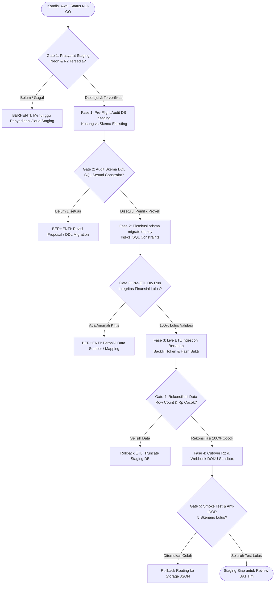
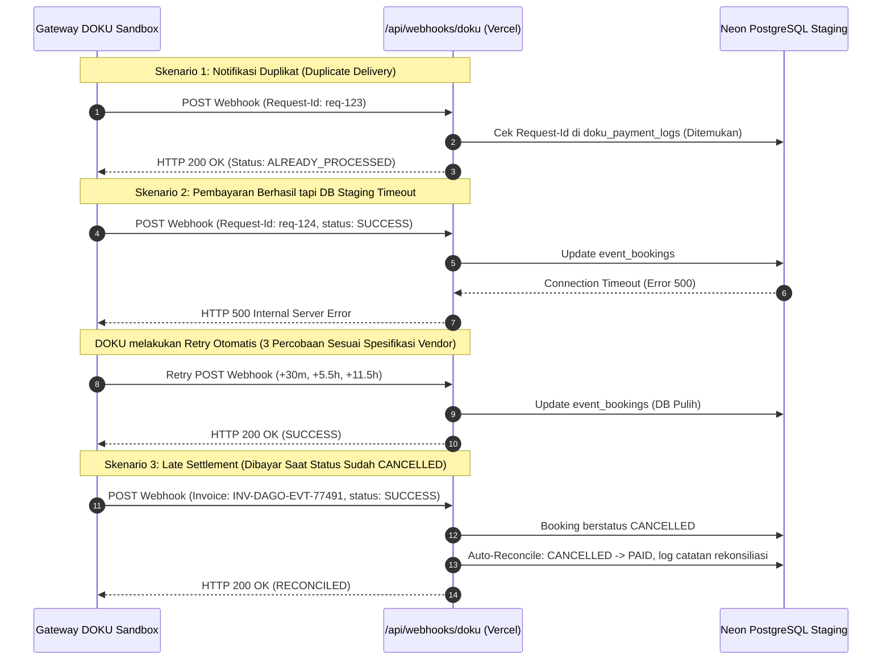

# DAGOENG — STAGING MIGRATION RUNBOOK (DOCUMENTATION ONLY)

**Status Dokumen:** RUNBOOK OPERASIONAL — STRICTLY READ-ONLY & NON-DESTRUCTIVE  
**Versi:** 2.0 (Hardened Pre-Staging Specification)  
**Tanggal Audit:** 29 Oktober 2026  
**Target Environment:** Neon Serverless PostgreSQL Staging + Vercel Preview/Staging + Cloudflare R2 Staging  
**Audience:** DevOps, Lead Backend Engineer, Security Auditor, dan Project Owner  

---

## STATUS OTORISASI PROYEK (WAJIB DIPERTAHANKAN)

> [!CAUTION]
> **PERINGATAN STATUS SISTEM SAAT INI:**
> - Database Staging: **BELUM TERSEDIA / BELUM DIVERIFIKASI**
> - Modifikasi `prisma/schema.prisma`: **BELUM DISETUJUI UNTUK EKSEKUSI**
> - Migrasi Prisma DDL: **BELUM DIOTORISASI**
> - ETL Aktual (JSON &rarr; PostgreSQL): **BELUM DIOTORISASI**
> - Pemindahan Bukti ke Cloudflare R2: **BELUM DIOTORISASI**
> - Status Kesiapan Produksi Publik: **STRICT NO-GO**
>
> Dokumen ini adalah spesifikasi operasional bersyarat (*Conditional Runbook*). Seluruh perintah di dalamnya **DILARANG DIJALANKAN** sebelum setiap gerbang persetujuan (*Approval Gate*) pada Bagian 10 ditandatangani oleh pemilik proyek.

---

## 1. VERIFIKASI KONDISI AWAL & INTEGRITAS BASELINE

Pemeriksaan integritas repositori lokal dijalankan secara baca-saja sebelum runbook ini dimutakhirkan:

| Parameter Audit | Fakta Terverifikasi | Status |
|---|---|---|
| `git status --short` | Baseline bersih (commit `a358ebb`), hanya file dokumentasi baru yang ada. | Terverifikasi Aman |
| `git diff --stat` | *(Output kosong)* — Tidak ada modifikasi kode aktif yang belum di-commit. | Bersih |
| `prisma/schema.prisma` | 537 baris, 32 model terdefinisi, tidak termutasi. | Terlindungi |
| `prisma/migrations` | Direktori belum ada di repository (`False`). | Belum Ada Riwayat |
| Dokumen Acuan | Keempat dokumen acuan (`BLUEPRINT`, `ETL_REPORT`, `SCHEMA_PROPOSAL`, `APPROVAL_CHECKLIST`) hadir utuh. | Lengkap |
| `npm run type-check` | TypeScript Compiler (`tsc --noEmit`) menghasilkan `Exit Code: 0`. | 0 Error |
| `npm test` | Vitest Suite: 53 file pengujian lulus (573 test passed, 0 failed). | 100% Lulus |

---

## 2. DIAGRAM TAHAPAN BERSYARAT & GERBANG PERSETUJUAN (APPROVAL GATES)

Diagram di bawah ini menggambarkan alur kerja yang diwajibkan. Setiap transisi fase dibatasi oleh gerbang persetujuan formal (*Approval Gate*) dan **berhenti otomatis** jika kriteria evaluasi belum terpenuhi:



---

## 3. RUNBOOK PEMBUATAN BASELINE SKEMA (KOSONG VS SKEMA EKSISTING)

### 3.1 Pre-Flight Audit Database Target (Wajib Dijalankan Pertama)
Sebelum menjalankan perintah Prisma apapun, periksa status fisik database staging melalui koneksi direct PostgreSQL:

```sql
-- Query 1: Periksa apakah sudah ada tabel di schema public
SELECT table_name 
FROM information_schema.tables 
WHERE table_schema = 'public';

-- Query 2: Periksa riwayat migrasi Prisma
SELECT * FROM "_prisma_migrations";
```

### 3.2 Penanganan Berdasarkan Kondisi Database Staging

#### Kasus A — Database Staging 100% Kosong (Kondisi Ideal)
1. Buat branch git terpisah:
   ```bash
   git checkout -b feature/staging-baseline-migration
   ```
2. Tambahkan deklarasi `directUrl` pada datasource `prisma/schema.prisma`:
   ```prisma
   datasource db {
     provider  = "postgresql"
     url       = env("DATABASE_URL")
     directUrl = env("DIRECT_URL")
   }
   ```
3. Tambahkan 5 model Event Marketplace dan 3 model Multi-Outlet Inventory dari [DAGOENG_PRISMA_SCHEMA_PROPOSAL.md](file:///d:/Magang%20Shandi/DagoEng%20F&B%20Management/DAGOENG_PRISMA_SCHEMA_PROPOSAL.md#L58-L230).
4. Buat file migration tanpa langsung dieksekusi:
   ```bash
   npx prisma migrate dev --name init_baseline --create-only
   ```
5. Audit file `prisma/migrations/*_init_baseline/migration.sql` dan injeksikan constraints (lihat Bagian 3.3).
6. Terapkan DDL:
   ```bash
   npx prisma migrate deploy
   ```

#### Kasus B — Database Staging Sudah Memiliki Tabel atau Sisa Percobaan Sebelumnya
> [!WARNING]
> Jangan langsung menjalankan `init_baseline` jika database sudah memiliki tabel! Tindakan tersebut dapat menyebabkan konflik skema atau kegagalan deklarasi foreign key.

1. Jalankan audit perbedaan skema (*drift detection*):
   ```bash
   npx prisma migrate diff \
     --from-empty \
     --to-schema-datamodel prisma/schema.prisma \
     --script > proposed_schema.sql
   ```
2. **Pilihan Tindakan Bersyarat**:
   - **Opsi B.1 (Paling Bersih & Direkomendasikan)**: Jika database staging hanya berisi tabel uji coba lama, minta izin pemilik proyek untuk mereset bersih schema `public`:
     ```sql
     DROP SCHEMA public CASCADE;
     CREATE SCHEMA public;
     ```
     Setelah bersih, lanjutkan dengan alur **Kasus A**.
   - **Opsi B.2 (Jika Staging Tidak Boleh Dihapus)**: Gunakan `prisma migrate resolve` atau `prisma db pull` terisolasi untuk merekonsiliasi state migrasi yang terputus.

---

### 3.3 Verifikasi SQL Constraints Sesuai Data Warisan & Model Usulan

File `migration.sql` hasil generate wajib diperiksa secara teliti sebelum di-deploy. Constraint berikut disuntikkan secara manual dengan aturan non-destruktif:

```sql
-- 1. Validasi Rentang Jumlah Tiket & Check-in Parsial
-- AMAN: Seluruh data booking warisan memiliki ticketCount >= 1 dan checkedInQty = 0
ALTER TABLE "event_bookings" 
  ADD CONSTRAINT "chk_ticket_count_positive" 
    CHECK ("ticket_count" > 0),
  ADD CONSTRAINT "chk_checked_in_qty_range" 
    CHECK ("checked_in_qty" >= 0 AND "checked_in_qty" <= "ticket_count");

-- 2. Validasi Kapasitas Event (NULL-Safe)
-- PERINGATAN KRITIS: JANGAN membuat constraint 'CHECK (max_capacity > 0)' tanpa 'IS NULL'!
-- Event 'evt-latte-art-2026' dan 'evt-community-cleanup-2026' memiliki max_capacity = NULL.
-- Constraint berikut aman untuk data warisan maupun data baru:
ALTER TABLE "community_events"
  ADD CONSTRAINT "chk_max_capacity_positive_or_null" 
    CHECK ("max_capacity" IS NULL OR "max_capacity" > 0);

-- 3. Validasi Harga Pokok Bahan Baku
ALTER TABLE "inventory_ingredients"
  ADD CONSTRAINT "chk_cost_per_unit_non_negative" 
    CHECK ("cost_per_unit" >= 0);

-- 4. Validasi Idempotensi Pengurangan Stok POS
-- Memastikan 1 item pes POS hanya dapat memotong stok 1x per tipe movement
-- (Sudah terdefinisi di model Prisma sebagai @@unique([orderItemId, ingredientId, movementType]))
```

---

### 3.4 Larangan Eksplisit Menjalankan `prisma/seed.ts`

> [!CAUTION]
> **DILARANG KERAS MENJALANKAN PERINTAH BERIKUT DI STAGING ATAU DATABASE AKTIF:**
> ```bash
> # DILARANG:
> npm run prisma:seed
> npm run db:seed
> npx prisma db seed
> npx tsx prisma/seed.ts
> ```
>
> **ALASAN TEKNIS:**
> Berkas [prisma/seed.ts](file:///d:/Magang%20Shandi/DagoEng%20F&B%20Management/prisma/seed.ts#L10-L28) memuat baris pembersihan agresif:
> ```typescript
> await prisma.auditLog.deleteMany();
> await prisma.session.deleteMany();
> await prisma.table.deleteMany();
> await prisma.product.deleteMany();
> await prisma.customer.deleteMany();
> await prisma.user.deleteMany();
> await prisma.outlet.deleteMany();
> await prisma.organization.deleteMany();
> ```
> Menjalankan perintah seed akan **menghapus seluruh record organisasi, outlet, user, kasir, dan katalog produk** tanpa dialog konfirmasi. Seluruh pengujian awal di staging harus menggunakan data migrasi ETL, BUKAN data acak dari `seed.ts`.

---

## 4. RUNBOOK MIGRASI DATA (ETL: JSON KE POSTGRESQL)

### 4.1 Preconditions Sebelum Live ETL
1. Skema database staging telah ter-deploy dan berstatus `Database schema is up to date`.
2. Validasi offline lulus 100%:
   ```bash
   npm test tests/etl-data-validation.test.ts
   ```
3. Backup salinan data JSON di `data/.backups/` telah diverifikasi integritasnya.

### 4.2 Pemetaan Entitas & Penanganan Anomali Warisan

| Entitas Target | Sumber Data | Pemetaan ID & Key | Aturan Penanganan Anomali |
|---|---|---|---|
| `community_organizers` | `data/organizers.json` (9) | `id` &larr; `id` (e.g. `org-comm-barista`), `email` &rarr; UNIQUE | Ingest seluruh 9 mitra resmi dengan status `ACTIVE`. |
| `community_events` | `data/events.json` (16) | `id` &larr; `id` (e.g. `evt-latte-art-2026`) | - 10 event cocok &rarr; set `organizerId`.<br>- 6 event publik &rarr; set `organizerId: NULL`, `organizerEmail: "<email-pengaju>"` (tidak ada akses edit publik).<br>- 2 event tanpa kuota &rarr; pertahankan `maxCapacity: NULL`, `isCapacityConfirmed: false`. |
| `event_bookings` | `data/event_bookings.json` (8) | `id` &larr; `id` (e.g. `tkt-latte-001`), `ticketCode` &larr; `ticketCode` (e.g. `DAGO-EVT-77491`) | - Pertahankan status asli: 6 PAID, 1 PENDING, 1 CANCELLED.<br>- **JANGAN MENGUBAH STATUS PEMBAYARAN** demi rekonsiliasi angka!<br>- Lakukan backfill `guestToken` kriptografis untuk 3 booking. |
| `event_payment_proofs` | `data/proofs/` (2) | `bookingId` &rarr; FK ke `event_bookings.id` | - Hitung ulang SHA-256 lokal.<br>- Upload ke R2 staging, catat `storageKey`.<br>- **SUMBER LOKAL DILARANG DIHAPUS**. |

### 4.3 Strategi Backfill `guestToken` & Kebijakan Keamanan Logging
Tiga data riwayat transaksi belum memiliki `guestToken`:
- `DAGO-EVT-48246` (`tkt-1793006245099-bpw9k`, Status: `CANCELLED`)
- `DAGO-EVT-77491` (`tkt-latte-001`, Status: `PAID`, Tamu: `b***@gmail.com`)
- `DAGO-EVT-88219` (`tkt-latte-002`, Status: `PAID`, Tamu: `c***@gmail.com`)

**Aturan Implementasi & Keamanan**:
1. Token di-generate menggunakan `crypto.randomBytes(24).toString('hex')` (48 karakter hex).
2. **KEBIJAKAN ZERO TOKEN EXPOSURE DI LOG**:
   ```typescript
   // DILARANG:
   console.log(`Token generated: ${guestToken}`); // PELANGGARAN KEAMANAN!

   // WAJIB:
   console.info(`[ETL Backfill] Token generated for booking ${booking.ticketCode} (HashPrefix: ${guestToken.slice(0, 6)}***)`);
   ```
3. **STATUS FITUR PEMULIHAN TIKET (BELUM TERSEDIA / UNIMPLEMENTED)**:
   - *Koreksi Audit*: Rute `/events/recover-ticket` **BELUM TERSEDIA** di codebase.
   - Untuk mencegah pemilik tiket warisan kehilangan akses ke tautan privat tiket mereka pasca-migrasi, pemilik proyek harus menetapkan salah satu dari dua alternatif sebelum cutover:
     - **Alternatif A (Pemulihan Mandiri Aman)**: Membangun endpoint dan antarmuka `/events/recover-ticket` baru dengan verifikasi ganda (`ticketCode` + `guestEmail`) yang dilindungi *rate-limiting* ketat untuk mencegah enumerasi token.
     - **Alternatif B (Bantuan Manual Terverifikasi)**: Prosedur operasional di mana admin memverifikasi identitas pembeli via kanal resmi (email/WhatsApp terdaftar) dan menyerahkan tautan tiket privat yang telah di-backfill secara langsung.
   - **PERINGATAN**: Dilarang menampilkan token telanjang atau email pribadi pembeli pada log publik sistem.

### 4.4 Strategi Idempotensi & Retry ETL
Agar script ETL dapat dijalankan ulang jika terjadi putus koneksi di tengah jalan, seluruh operasi *insert* wajib menggunakan mekanisme **Upsert / On Conflict Do Update**:
```typescript
await prisma.communityEvent.upsert({
  where: { id: event.id },
  update: { ...eventPayload },
  create: { id: event.id, ...eventPayload },
});
```

### 4.5 Rekonsiliasi Finansial & Data Parsial
Setelah ETL selesai, jalankan query audit finansial pada Neon staging:
```sql
SELECT 
  payment_status, 
  COUNT(*) AS total_tickets, 
  SUM(total_price) AS nominal_idr
FROM event_bookings
GROUP BY payment_status;
```

**Kriteria Lulus Rekonsiliasi Finansial (Sesuai Audit Data Faktual):**
- `PAID`: Tepat 6 transaksi = **Rp 506.000** (termasuk 2 tiket gratis Rp 0)
- `PENDING`: Tepat 1 transaksi = **Rp 1.000.000**
- `CANCELLED`: Tepat 1 transaksi = **Rp 200.000**
- **TOTAL KESELURUHAN**: Tepat 8 transaksi = **Rp 1.706.000**

Jika ada selisih nominal bahkan sebesar Rp 1, proses migrasi dinyatakan **GAGAL**. Data sumber di `data/event_bookings.json` tidak boleh diubah.

---

## 5. RUNBOOK CUTOVER BUKTI TRANSFER & INTEGRITAS CHECKSUM R2

### 5.1 Verifikasi Checksum SHA-256 Sebelum & Sesudah Upload
1. Hitung hash biner file lokal di `data/proofs/` (Nilai Terverifikasi Biner Aktual):
   - `proof-dago-evt-51628-1793179519555.png` (588.864 bytes): `05a9d413298885a99b7993e08809019fd464f62c0f75751c776ef7d6e40c3d24`
   - `proof-dago-evt-72676-1793179816938.png` (143.997 bytes): `bc37d23026012de4fdad3b5da743a3682fa007dfeec2f790cc6081faf4effa47`
2. Upload biner ke bucket R2 staging (`dago-proofs-staging`).
3. Download ulang biner dari R2 melalui API staging dan bandingkan hash-nya. Keduanya **wajib identik byte-for-byte**.
4. **LARANGAN PENGHAPUSAN SUMBER LOKAL**:
   - Direktori `data/proofs/` dan `data/backup_legacy_proofs/` **TETAP DIPERTAHANKAN** di disk lokal.
   - Penghapusan file lokal BUKAN bagian dari migrasi staging, melainkan menjadi *cold master backup* permanen.

---

## 6. RUNBOOK KETAHANAN WEBHOOK DOKU (EDGE CASES & RETRY)

Pengujian webhook DOKU di lingkungan staging wajib mencakup 4 skenario ekstrem:



1. **Skenario 1 (Notifikasi Duplikat)**: Mengirim webhook dengan `Request-Id` yang sama persis sebanyak 3x. Respon ke-2 dan ke-3 wajib langsung `200 ALREADY_PROCESSED` tanpa efek samping.
2. **Skenario 2 (Notifikasi Tidak Berurutan / Webhook Tiba Sebelum Booking Tercatat)**: Webhook mencatat status `ORPHAN_INVOICE_PENDING_RECONCILIATION` dan merespons retry.
3. **Skenario 3 (Late-Settlement Auto-Heal)**: Booking yang sempat dibatalkan karena batas waktu otomatis direkonsiliasi menjadi `PAID` begitu notifikasi `SUCCESS` dari bank tiba.
4. **Skenario 4 (Kebijakan Retry DOKU & Kegagalan Database)**: 
   - Jika database staging mengalami error/timeout saat memproses pembayaran sukses, API **wajib mengembalikan HTTP 500** agar DOKU menjadwalkan pengiriman ulang.
   - Sesuai dokumentasi resmi DOKU HTTP Notification, sistem gateway melakukan retry otomatis sebanyak **3 kali** dengan jadwal:
     - Retry ke-1: +30 menit dari percobaan pertama
     - Retry ke-2: +5,5 jam dari percobaan pertama (total 6 jam)
     - Retry ke-3: +11,5 jam dari percobaan pertama (total 12 jam)
   - Jika 3 kali retry habis dan server masih belum pulih, pengiriman ulang harus dipicu manual via dashboard DOKU Back Office (*Integration > HTTP Notification > Retry*).
   - *Catatan Pengujian*: Implementasi aktual di staging tetap wajib diuji secara empiris terhadap perilaku sandbox DOKU.

---

## 7. MATRIKS TESTING & VALIDASI OPERASIONAL STAGING

| ID Test | Skenario Validasi | Target Rute / Handler | Kriteria Kelulusan Mutlak |
|---|---|---|---|
| **ST-01** | Transaksi POS F&B & Pemotongan Stok | `POST /api/orders` | Transaksi `PAID`, stok berkurang akurat pada `inventory_ingredients`, baris `stock_movements` tercatat. |
| **ST-02** | Reservasi Coworking & Deteksi Bentrok | `POST /api/coworking/book` | Reservasi tersimpan, sistem menolak jadwal tumpang tindih (*double booking*) pada ruangan yang sama. |
| **ST-03** | Pembelian Tiket & Concurrency Lock | `POST /api/events/bookings/create` | Transaksi menggunakan `SELECT FOR UPDATE`. Kuota tidak pernah terlampaui saat 50 request bersamaan. |
| **ST-04** | Verifikasi Bukti Bayar Manual & Door QR | `GET /api/events/proofs/[filename]` | Struk transfer hanya tampil jika menyertakan token sah atau sesi admin. QR scanner membaca tiket. |
| **ST-05** | Audit Isolasi Lintas Tenant (Anti-IDOR) | Pemanggilan API tenant lain | Akses ditolak dengan HTTP 403 Forbidden. Tidak ada kebocoran data menu/stok antar stan. |

---

## 8. PROSEDUR ROLLBACK & DISASTER RECOVERY BERLAPIS

Jika terjadi kegagalan di lingkungan staging, pemulihan dilakukan secara terpisah berdasarkan lapisan arsitektur:

```
[Level A: Rollback DDL Skema]
  → DROP SCHEMA public CASCADE; CREATE SCHEMA public;

[Level B: Rollback Data ETL]
  → TRUNCATE TABLE event_payment_proofs, doku_payment_logs, event_bookings, community_events, community_organizers CASCADE;

[Level C: Rollback Object Storage]
  → Hapus bucket staging dago-proofs-staging; sumber data lokal data/proofs/ tetap utuh 100%.

[Level D: Rekonsiliasi Finansial Eksternal]
  → PERINGATAN: Transaksi uang riil di DOKU TIDAK BISA di-rollback oleh SQL!
    Wajib melalui prosedur refund/settlement manual di DOKU Merchant Back Office.
```

> [!IMPORTANT]
> **BATASAN ROLLBACK FINANSIAL:**
> Rollback database atau serverless code **TIDAK MEMBATALKAN UANG YANG SUDAH TERDEBET DARI REKENING NASABAH**. Jika pengujian di staging melibatkan transaksi pembayaran nyata (bukan sandbox simulasi), setiap dana yang masuk wajib direkonsiliasi secara manual melalui fitur refund di Merchant Dashboard DOKU.

---

## 9. TRANSISI CLIENT STATE & LOCALSTORAGE CUTOVER

1. **Pembersihan State Klien Lama**:
   - Klien yang masih menyimpan auth mock atau keranjang offline lama pada browser localStorage wajib dialihkan secara elegan melalui script inisialisasi sesi baru:
   ```typescript
   // src/lib/client-storage-cleanup.ts
   if (typeof window !== "undefined") {
     const schemaVersion = localStorage.getItem("dago_schema_version");
     if (!schemaVersion || Number(schemaVersion) < 2) {
       console.info("[Auth Migration] Migrating client storage to Serverless Session...");
       localStorage.removeItem("legacy_cart_token");
       localStorage.setItem("dago_schema_version", "2");
     }
   }
   ```
2. **Graceful Degradation**:
   - Jika endpoint database mengalami latensi tinggi, komponen frontend menampilkan indikator loading transparan tanpa crash.

---

## 10. TABEL GERBANG PERSETUJUAN RESMI (APPROVAL GATES)

Seluruh aktivitas staging diwajibkan mengikuti matriks gerbang persetujuan berikut:

| ID Gate | Tahapan Kegiatan | Prasyarat Wajib | Bukti / Artefak yang Wajib Tersedia | PIC / Penanggung Jawab | Status Aktual | Kriteria Kelulusan untuk Melanjutkan |
|---|---|---|---|---|---|---|
| **GATE-01** | **Penyediaan Infrastruktur Staging** | Akun Neon PG & Cloudflare R2 aktif | String koneksi `DIRECT_URL` & `DATABASE_URL`, kredensial R2 bucket `dago-proofs-staging` | DevOps / Cloud Admin | `PENDING` | Koneksi database staging berhasil diuji dengan `SELECT 1;`. |
| **GATE-02** | **Persetujuan Skema & DDL Baseline** | Gate 01 Lulus, Proposal v2.0 disetujui | File `migration.sql` hasil generate dengan validasi constraint lengkap | Lead Backend / Tech Lead | `PENDING` | DDL ter-deploy tanpa error dan diverifikasi via `prisma migrate status`. |
| **GATE-03** | **Otorisasi Eksekusi ETL Staging** | Gate 02 Lulus, Pre-ETL test lulus 100% | Laporan `tests/etl-data-validation.test.ts` (0 error, nominal Rp 1.706.000) | Data Engineer / Auditor | `PENDING` | Seluruh 16 event, 8 booking, dan 9 organizer tersimpan dengan referensi foreign key sah. |
| **GATE-04** | **Verifikasi Rekonsiliasi & R2 Storage** | Gate 03 Lulus, file bukti ter-upload | Laporan perbandingan SHA-256 hash biner lokal vs R2 stream | Security Lead / QA | `PENDING` | Seluruh 2 bukti transfer terverifikasi identik dan terlindungi akses privat. |
| **GATE-05** | **UAT & Smoke Test Operasional** | Gate 04 Lulus, Webhook DOKU sandbox aktif | Laporan kelulusan 5 skenario test (`ST-01` s/d `ST-05`) | QA Lead / Store Manager | `PENDING` | Seluruh alur POS, reservasi, ticketing, dan anti-IDOR lulus 100%. |
| **GATE-06** | **Keputusan Final Cutover Produksi** | Gate 01 s/d Gate 05 Lulus tanpa catatan | Berita acara UAT & persetujuan tertulis pemilik proyek | Project Owner (Shandi Aditya) | **STRICT NO-GO** | Ditandatangani resmi oleh pemilik proyek sebelum domain publik diarahkan. |

---
*Dokumen ini disusun sebagai panduan teknis operasional terstandarisasi. Tidak ada kode, skema, database, data JSON, environment variables, atau riwayat Git yang dimutasi selama penyusunan dokumen ini.*
