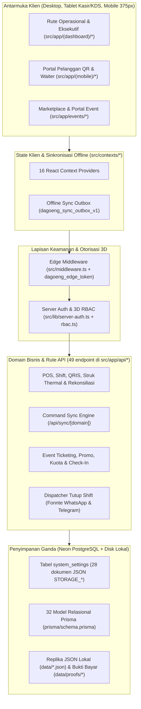

# Arsitektur sistem DagoEng Management

DagoEng Management dibangun sebagai **modular monolith** berbasis **Next.js `15.5.29` (App Router)**, **React `19.3.1`**, **TypeScript `5.6.3`**, **Tailwind CSS `4.3.5`**, dan komponen **shadcn `4.23.0`** di atas **`@base-ui/react` `1.9.0`**. Satu basis kode melayani operasional multi-unit di bawah **Dago Creative Hub** (`org-dago-hub`), yang mencakup POS F&B multi-mitra, Co-Working Space, sewa ruang komersial, dan marketplace event komunitas.

## 1. Aliran lapisan sistem

## 2. Organisasi aktif, gerai, dan mitra F&B

Konfigurasi operasional aktif dikunci pada entitas berikut di `src/lib/receipt-publisher.ts`, `src/contexts/OutletContext.tsx`, dan `src/lib/sync-domains/config-spec.ts`:

- **Organisasi induk.** `Dago Creative Hub` (`org-dago-hub`, kode `DAGO-HUB`).
- **Gerai operasional aktif.** `Singaraja (Pusat)` (`outlet-sgr`, kode `KS-SGR`, beralamat di Jl. Teleng No. 1, Banyuasri, Buleleng, Bali 81116). Dua gerai ekspansi (`Denpasar` `KS-DPS` dan `Ubud` `KS-UBD`) berstatus `COMING_SOON` dan belum menerima transaksi.
- **Empat mitra kuliner F&B resmi.** `Kopi Senja` (`tenant-ks`), `Dapur Mama` (`tenant-kitchen`), `Manis Bakery` (`tenant-bakery`), dan `Warung Bu Narti` (`tenant-tea`). Kebijakan bawaan membagi hasil `85%` untuk mitra dan `15%` untuk Dago Creative Hub dari nilai DPP sebelum PB1 (`RECEIPT_NET_BEFORE_TAX`).

## 3. Struktur modul dan pemisahan tanggung jawab

Perhitungan jumlah berkas sumber pada repositori ini dapat direproduksi dengan perintah `find src/app -name 'page.tsx' | wc -l`, `find src/app/api -name 'route.ts' | wc -l`, `ls -1 src/contexts/*.tsx | wc -l`, dan `ls -1d src/features/* | wc -l`:

- **`src/app/` (29 halaman `page.tsx` dan 49 handler `route.ts`).** Mengelola routing halaman publik (`/` dan `/events/*`), autentikasi (`/login`), ruang kerja terproteksi (`src/app/(dashboard)/*`), tampilan seluler (`/customer` dan `/waiter`), serta endpoint REST internal (`src/app/api/*`).
- **`src/components/ui/` (38 primitif) dan `src/components/app/` (komponen komposit aplikasi).** Menyediakan fondasi desain berbasis token semantik CSS (`globals.css`) dan `@base-ui/react` gaya `base-mira`. Direktori warisan `src/components/legacy/` telah dihapus seluruhnya. Detail aturan antarmuka terdapat di [DESIGN_SYSTEM.md](./DESIGN_SYSTEM.md).
- **`src/contexts/` (16 provider React Context).** Mengorkestrasi state lintas komponen, hidrasi data dari server, serta polling berkala setiap 5 detik untuk antrean pesanan (`OrderContext`) dan stok bahan (`InventoryContext`).
- **`src/features/` (29 direktori fitur).** Memuat komponen antarmuka spesifik domain beserta logika murni perhitungan domain (`*-domain.ts`, `kitchen-board.ts`, `reconciliation-domain.ts`, `pos-closing-report.ts`).
- **`src/lib/` dan `src/types/` (17 berkas tipe).** Menyimpan mesin otorisasi, sesi Edge dan database, penyimpanan persisten atomik, perhitungan pajak dan bagi hasil, template ekspor Excel tiga lembar (`transaction-export-template.ts`), antarmuka printer thermal (`printer.ts`), serta integrasi WhatsApp dan Telegram (`closing-chatbot.ts`).

## 4. Keamanan sesi, otorisasi 3D, dan pencabutan lintas perangkat

Sistem menggabungkan pemeriksaan cepat pada Edge Runtime dengan validasi penuh di Node Runtime:

1. **Token ganda berumur operasional 16 jam (`57.600` detik).** Saat pengguna berhasil masuk di `POST /api/auth/login`, server menerbitkan `dagoeng_edge_token` (`HttpOnly`, bertanda tangan HMAC-SHA256 menggunakan `SESSION_SECRET`) untuk pemeriksaan cepat di `src/middleware.ts`, serta `dagoeng_session` (`HttpOnly`, disimpan sebagai hash SHA-256 pada tabel `sessions`) untuk sesi akun terpadu dan organizer.
2. **Batas diam staf dan pencabutan sesi instan.** `AuthContext` memantau aktivitas staf dengan batas diam 8 jam (`STAFF_IDLE_TIMEOUT_MS`) dan memeriksa `GET /api/auth/session` setiap 60 detik. Ketika admin mengubah peran atau kata sandi karyawan melalui `PUT /api/employees`, server mencatat waktu pencabutan di `STORAGE_session_revocations.json` sehingga sesi lama pada perangkat lain langsung diputus.
3. **Otorisasi 3-dimensi.** Setiap akses rute dan mutasi data dievaluasi terhadap kombinasi `RoleSlug`, `ScopeLevel`, dan `BusinessModuleCode`. Rincian matriks hak akses dibahas di [RBAC.md](./RBAC.md).

## 5. Penyimpanan replika awan dan ketahanan offline

Untuk menjaga kecepatan kasir sekalipun jaringan melambat, aplikasi menerapkan arsitektur penyimpanan dua lapis yang dirinci pada [DATABASE.md](./DATABASE.md) dan [AUDIT_PENYIMPANAN_DATA.md](./AUDIT_PENYIMPANAN_DATA.md):

- **Replikasi server ke Neon PostgreSQL.** Berkas operasional disimpan secara atomik per nama berkas (`withFileLock`) ke `<cwd>/data/<filename>.json` dan disinkronkan ke tabel `system_settings` dengan kunci `STORAGE_<filename>` menggunakan pengecekan versi optimis `updatedAt` (Compare-And-Swap) serta batas waktu baca 8 detik.
- **Outbox sinkronisasi peramban.** Mutasi domain melalui `SyncedDomainClient` (`src/lib/domain-sync.ts`) dicerminkan ke `localStorage` dan dimasukkan ke antrean `dagoeng_sync_outbox_v1` (`src/lib/sync-outbox.ts`). Ketika koneksi kembali pulih (`online` atau `visibilitychange`), antrean dikirim ulang secara berurutan tanpa duplikasi.

## 6. Alur operasional POS, KDS, printer thermal, dan tutup shift

1. **Pembayaran dan nomor struk berurutan.** Pembayaran hanya diizinkan bila kasir memiliki shift berstatus `OPEN`. Pembayaran QRIS pada POS dan Co-working wajib terverifikasi melalui webhook HMAC `/api/pos/qris/verify` atau otorisasi PIN supervisor beserta nomor RRN bank minimal 4 karakter. Nomor struk dibentuk berurutan per penerbit setiap hari sesuai zona waktu WITA (`Asia/Makassar`).
2. **Isolasi dapur multi-mitra dan notifikasi 5 detik.** `OrderContext` melakukan polling `/api/orders` setiap 5 detik. Pesanan lintas mitra dipecah status dapurnya menggunakan peta `tenantStatuses` per mitra. Layar `/kitchen` menampilkan popup pesanan baru berbunyi lonceng WebAudio khusus item milik mitra terkait, sedangkan layar `/waiter` memunculkan peringatan ketika pesanan berstatus siap saji.
3. **Cetak tiket dapur senyap lima tingkat.** Saat kasir mencetak struk pelanggan di `ReceiptModal` dan opsi `autoPrintKitchenOrder` aktif, `src/lib/printer.ts` memecah tiket dapur per mitra tanpa mencantumkan harga. Pengiriman cetak mencoba lima jalur secara berurutan: `LOCAL_BRIDGE` (`localhost:8080/print`), `NETWORK_LAN_VIA_BRIDGE` (`localhost:8080/lan-print`), `QZ_TRAY` (`localhost:8182/qz/print`), `PRINTNODE` (`localhost:8080/printnode`), lalu fallback `iframe` tersembunyi untuk Chrome mode `--kiosk-printing`.
4. **Rekonsiliasi laci kas dan chatbot tutup shift.** Penutupan shift menghitung kas seharusnya (`Modal Awal + Penjualan Tunai - Refund Kas`), mewajibkan alasan apabila terdapat selisih kas aktual, menyediakan dokumen cetak Front Office, dan memicu `src/lib/closing-chatbot.ts` untuk mengirim rekap lengkap ke Ka Ari serta rekap bagi hasil terisolasi ke masing-masing mitra F&B melalui WhatsApp Fonnte dan Bot Telegram.
