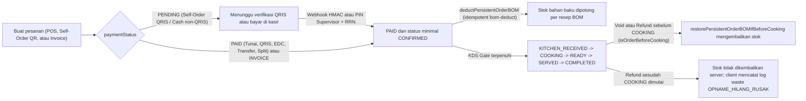

# Dokumentasi teknis POS dan hasil audit laporan serta role matriks (V-35)

Dokumen ini merangkum alur pembayaran, status pesanan, dan stok bahan baku (BOM) POS untuk serah terima teknis, merekap hasil review MR POS Shandi (`S-35`, `S-36`, `S-38`, `S-39`), serta mencatat hasil pemeriksaan laporan (`#1` sampai `#4`, `#7` sampai `#9`, `#11`) dan Role Matriks pada cabang `develop` (commit `2823a23`). Pemeriksaan bersifat audit tanpa mengubah perilaku kode aplikasi.

## 1. Alur pembayaran, status pesanan, dan stok (BOM)

### Alur pembayaran

1. **Tunai (`CASH`) di POS.** Kasir menginput nominal terima minimal sebesar tagihan (`grandTotal`) pada `src/features/pos/PaymentModal.tsx`. Pesanan tersimpan sebagai `CONFIRMED` dan `PAID`, lalu menambah `cashSales` pada shift aktif kasir.
2. **QRIS (`QRIS`) di POS dan pemesanan mandiri.** Modal pembayaran POS maupun `POST /api/orders/self-order` mendaftarkan sesi `PENDING` ke `qris_sessions.json` lewat `POST /api/pos/qris/verify` mode `INIT`. Pelunasan server hanya sah lewat verifikasi webhook HMAC-SHA256 (`VERIFIED_WEBHOOK`) atau override PIN supervisor disertai nomor RRN minimal 4 karakter (`VERIFIED_SUPERVISOR`). Order POS baru memanggil `claimQrisSessionForOrder` agar satu sesi QRIS hanya dipakai satu pesanan, sedangkan pemesanan mandiri dilunaskan langsung oleh `settleMatchingPendingTarget`. Catatan arsitektur saat ini, `src/app/api/webhooks/doku/route.ts` hanya menangani tiket Web Event dan belum melayani order POS.
3. **Kartu (`EDC`), transfer (`TRANSFER`), dan metode campuran (`SPLIT`).** Ketiganya menandai pesanan langsung `PAID` dan `CONFIRMED` (`TRANSFER` mewajibkan referensi transfer serta menulis log `TRANSFER_PAYMENT`). Metode `SPLIT` menyimpan pecahan nominal per cara bayar pada `splitDetails` sehingga shift kasir mencatat porsi tunai ke `cashSales` dan porsi non-tunai ke `nonCashSales`.
4. **Piutang korporat (`INVOICE`).** Hanya peran berhak menulis pesanan yang dapat menerbitkan pesanan korporat berstatus `PAID` tertunda (`PENDING`). Pesanan `INVOICE` dikecualikan dari gerbang KDS dan tidak masuk ringkasan kas shift sampai pelunasan dicatat di `/orders`.
5. **Pemesanan mandiri (`/customer`).** `POST /api/orders/self-order` memaksa status awal `NEW` dengan `paymentStatus: "PENDING"`, menghitung ulang seluruh harga item, modifier, promo, PB1, dan service charge di server dari katalog, dan memblokir `CASH` secara bawaan apabila `qrSelfOrderQrisOnly` aktif.

### Status pesanan dan gerbang dapur

1. **Delapan status pesanan.** `src/types/order.ts` dan `src/lib/order-write-policy.ts` mendefinisikan urutan `NEW`, `CONFIRMED`, `KITCHEN_RECEIVED`, `COOKING`, `READY`, `SERVED`, dan `COMPLETED`, ditambah cabang terminal `CANCELLED`.
2. **Gerbang pembayaran KDS.** Status `KITCHEN_RECEIVED` sampai `COMPLETED` ditolak dengan kode `KDS_PAYMENT_REQUIRED` (`403`) selama `paymentStatus` masih `PENDING`, kecuali untuk pesanan `INVOICE`.
3. **Progres multi-mitra.** Pesanan gabungan beberapa mitra menyimpan status terpisah per mitra di `tenantStatuses`. Status utama pesanan dihitung sebagai tahap paling awal di antara seluruh mitra berdasarkan urutan `KITCHEN_STAGE_RANK`, sedangkan pengguna lingkup `TENANT` dan `KITCHEN_STAFF` hanya dapat mengubah porsi mitranya sendiri.
4. **Void dan refund.** Pembatalan pesanan sebelum lunas (`PENDING` ke `CANCELLED`) merupakan void, sedangkan pembatalan pesanan lunas (`PAID` ke `CANCELLED` dan `paymentStatus: "REFUNDED"`) merupakan refund. Di API server (`src/app/api/orders/route.ts` dan `src/lib/order-refund.ts`), kasir dan pemilik mitra wajib menyertakan alasan serta `SUPERVISOR_OVERRIDE_PIN`, dan metode refund dinormalisasi menjadi `CASH` yang mengurangi `expectedCash` shift serta membalikkan perolehan poin loyalty.

### Pemotongan, pemulihan, dan limbah stok (BOM)

1. **Pemotongan otomatis (`deductPersistentOrderBOM`).** Server di `src/lib/persistent-storage.ts` memotong bahan baku resep F&B secara atomik saat pesanan berstatus lunas atau `INVOICE` korporat, mengabaikan item co-working (`!isCoworkingOrderItem`), dan menjaga idempotensi memakai kunci `bom-deduct-<orderId>` serta penanda `bomDeducted`. Modifier berbahan substitusi dan tambahan ikut dihitung oleh `src/features/inventory/inventory-data.ts`.
2. **Batas pemulihan stok (`isOrderBeforeCooking`).** Saat void atau refund diproses sebelum status mana pun di pesanan atau `tenantStatuses` menyentuh `COOKING` dan `cookingStartedAt` masih kosong, `restorePersistentOrderBOMIfBeforeCooking` mengembalikan stok secara idempoten dengan kunci `bom-restore-<orderId>` dan `reason: "MANUAL_ADJUSTMENT"`.
3. **Limbah setelah dimasak.** Ketika `isOrderBeforeCooking` bernilai salah, server menolak pengembalian stok (`already-cooking-or-beyond`). Pencatatan limbah (`recordOrderWasteBOM` dengan `reason: "OPNAME_HILANG_RUSAK"`) saat ini dipanggil dari sisi antarmuka `/orders` (`src/app/(dashboard)/orders/page.tsx`) dan belum dipicu otomatis oleh endpoint server `/api/orders`.

## 2. Rekap review MR POS Shandi (`S-35`, `S-36`, `S-38`, `S-39`)

Seluruh MR POS Shandi yang dijadwalkan pada M2 sampai M4 sudah selesai di-review, diperbaiki, dan digabungkan ke `develop`.

1. **MR `!29` (`S-31` sampai `S-36`, digabungkan di commit `844349f`).** Mencakup kuota co-working (`S-35`) dan pesanan korporat (`S-36`) bersama perbaikan web event (`S-31` sampai `S-34`). Audit awal mengungkap celah kapasitas co-working tanpa lock server, akses invoice korporat oleh pelanggan, dan celah otorisasi sync. Perbaikan menambahkan pemeriksaan kapasitas atomik di server serta memperketat kebijakan `ORDER_WRITE_ROLES` dan otorisasi `COMMERCIAL` sebelum merge; rincian temuan terdokumentasi di [REVIEW_MR29_SHANDI_S31_S36.md](./REVIEW_MR29_SHANDI_S31_S36.md).
2. **MR `!31` (`S-38`, `S-39`, `S-41`, `S-42`, `S-43`, digabungkan di commit `2823a23`).** Mencakup kelola mitra di server (`S-38`) serta skema bagi hasil metode bayar, MDR QRIS, dan Laporan `#10`/`#11` (`S-39`). Putaran review dan perbaikan menutup kebocoran rekening/PKS di `/api/sync/tenants`, race condition TOCTOU undangan pemilik mitra, bypass order mitra `SUSPENDED`/`INACTIVE`, bug zona waktu `TZ=UTC` di settlement mingguan, status `Lunas` berbasis `localStorage`, pecahan `SPLIT` dan refund lintas minggu, serta penyelarasan angka `#10` dan `#11`; rincian terdokumentasi di [REVIEW_MR31_SHANDI_S38_S43.md](./REVIEW_MR31_SHANDI_S38_S43.md) dan diverifikasi ulang ke Neon test DB.

## 3. Hasil cek laporan (`#1` sampai `#4`, `#7` sampai `#9`, dan `#11`)

Pemeriksaan langsung dilakukan di `http://localhost:3099/reports` (database Neon test, periode default `01 Nov - 25 Nov 2026` serta minggu settlement `23 Nov - 29 Nov 2026`) dan diaudit terhadap kode `src/features/reports/reports-domain.ts`, `reconciliation-domain.ts`, `settlement-weekly-domain.ts`, `settlement-report-builders.ts`, dan `src/lib/transaction-export-template.ts`.

| Kode | Nama laporan di UI | Status | Role yang bisa buka | Bukti uji langsung & temuan formula / data untuk backlog |
|---|---|---|---|---|
| `#1` | `Penjualan POS` (`SALES`) | Salah | `SUPER_ADMIN`, Hub `OWNER`, `MANAGER`, Tenant `OWNER` (terfilter) | Live `01–25 Nov`: omzet `Rp 824.500`, `19` transaksi (`16` order F&B lunas `Rp 714.500` di `/orders` ditambah `3` transaksi co-working `Rp 110.000`), `Tunai Rp 519.700` vs `Nontunai Rp 304.800`. **Temuan kode:** pembayaran `SPLIT` masuk 100% ke `Nontunai` (`reports-domain.ts`), dan ekspor Excel `.xlsx` mengabaikan `coworkingBookings`, menghitung MDR dari total termasuk pajak, serta mengabaikan `SPLIT` QRIS (`transaction-export-template.ts`). |
| `#2` | `Closing kasir` (`CLOSING`) | Salah | `SUPER_ADMIN`, Hub `OWNER`, `MANAGER` | Live `01–25 Nov`: `12` shift, kas fisik `Rp 1.804.000`, selisih `Rp -611.000`. **Temuan kode:** format `"Rp -611.000"` gagal dideteksi tanda minusnya oleh `parseReportCellAmount` (dibaca `+611.000` saat pencarian) dan `ReportsPreviewTable.tsx` (tidak diwarnai merah); kolom `Refund tunai` dan `Penjualan nontunai` belum tampil di tabel. |
| `#3` | `Produk dan margin` (`PRODUCTS`) | Salah | `SUPER_ADMIN`, Hub `OWNER`, `MANAGER`, Tenant `OWNER` (terfilter) | Live `01–25 Nov`: `16` menu, margin `66.6%`, `24 pcs` terjual. **Temuan kode:** omzet produk memakai harga kotor sebelum diskon (`unitPrice * qty`), kartu rata-rata margin tetap membagi dengan seluruh `products.length` saat filter perusahaan aktif, dan item co-working di order gabungan tidak ikut terhitung. |
| `#4` | `Laporan metode bayar` | Belum ada | Tidak ada | Tidak ada tab terpisah pada `ReportType`. Pecahan metode bayar saat ini hanya tersebar di footer `Penjualan POS`, tab settlement mingguan (`#10`/`#11`), dan modal tutup shift POS. |
| `#7` | `Stok bahan` (`INVENTORY`) | Salah | `SUPER_ADMIN`, Hub `OWNER`, `MANAGER` | Live: `19` bahan, nilai stok `Rp 14.988.839`. Hanya menampilkan snapshot stok saat ini dan mengabaikan filter tanggal, tanpa riwayat mutasi BOM/PO/opname/waste maupun HPP terpakai. `INVENTORY_STAFF` ditolak membuka `/reports` oleh `route-guard.ts`. |
| `#8` | `Rekonsiliasi & selisih` (`RECONCILIATION`) | Salah | `SUPER_ADMIN`, Hub `OWNER`, `MANAGER` | Live: kasir fisik `Rp 1.804.000` vs seharusnya `Rp 2.669.700`, struk bersih `Rp 824.500` (kotor `Rp 978.000`), settlement `Rp 746.000`. **Temuan kode:** pesanan QRIS self-order yang di-void (`CANCELLED` + `PENDING`) masuk sebagai QRIS belum konfirmasi karena cek `PENDING` mendahului `CANCELLED`, baris gross/diskon menghitung order batal/refund, dan `totalReceiptsNet` memakai angka inklusif pajak sedangkan settlement memakai DPP. |
| `#9` | `Audit keuangan` (`FINANCE_AUDIT`) & `Tiket event` (`EVENTS`) | Ada (`EVENTS` ada bug) | Hub `OWNER`, `MANAGER`, `SUPER_ADMIN` (`EVENTS` khusus `ORGANIZATION`/`PLATFORM`) | Live `Audit keuangan`: `136` entri dari `13` pelaku. Live `Tiket event`: omzet `Rp 530.000`, `20` tiket, komisi DAGO `Rp 106.000`. **Temuan kode:** saat pencarian aktif pada `Tiket event`, `recalculateReportSummaryCards` ikut menjumlahkan baris berstatus `PENDING`, `CANCELLED`, dan `EXPIRED`. |
| `#11` | `Konsolidasi mitra` (`SETTLEMENT_CONSOLIDATED`) | Ada (bug minor edge case) | Lihat: `SUPER_ADMIN`, Hub `OWNER`, `MANAGER`. Ubah Lunas: `SUPER_ADMIN`, Hub `OWNER`. Tenant `OWNER` disembunyikan. | Live minggu `23–29 Nov`: omzet bersih konsolidasi `Rp 197.000` dan pendapatan DAGO `Rp 29.550` cocok tepat dengan jumlah `#10` (`Kopi Senja` `Rp 152.000`/`Rp 22.800` + `Dapur Mama` `Rp 45.000`/`Rp 6.750`). **Temuan kode:** karena `lib/order-refund.ts` memaksa `refundMethod: "CASH"`, refund lintas minggu transaksi QRIS memotong kanal tunai lalu ter-clamp `0` jika penjualan tunai minggu tersebut kecil; status `Lunas` multi-outlet berbagi satu kunci per `tenantId`. |

Hasil cek peran di browser: `owner.kopisenja@dagoeng.com` hanya melihat `4` tab terisolasi tenant tanpa `#11`, `manager.commercial@dagoeng.com` melihat `9` tab (tanpa `Tiket event`) dan tombol `Tandai lunas` pada `#10`/`#11` bersifat baca-saja, serta `cashier.sgr@kopisenja.com` yang membuka `/reports` langsung dialihkan ke `/pos`.

## 4. Hasil cek Role Matriks dan daftar catatan backlog

| Item Role Matriks V-35 | Status | Bukti pemeriksaan kode dan browser |
|---|---|---|
| Kelola meja: pindah meja | Belum ada | Modal meja di `/tables` (`src/features/tables/TableDetailModal.tsx`) hanya berisi 4 tombol status dan `Buka di POS`. Tidak ada command `MOVE_TABLE` di `spaces-spec.ts` maupun mutasi pemindahan `OrderRecord.tableNumber`. |
| Kelola meja: gabung meja | Belum ada | `TableItem` hanya menampung satu `activeOrderId`, tidak ada multi-pilih meja di `/tables` atau `/waiter`, dan tidak ada `MERGE_TABLES` atau gabung tagihan di `/pos` maupun `/orders`. |
| Kelola meja: split bill | Salah | Tab `SPLIT` pada `PaymentModal.tsx` hanya memecah metode pembayaran dalam satu transaksi tunggal dan mencetak satu struk `Rincian split payment`. Belum mendukung pecah tagihan per item atau penerbitan struk dan pembayaran independen per tamu. |
| Cetak ulang struk tercatat di audit log | Salah | Mengklik `Cetak thermal` dari `/orders` pada `INV-DAGO-20261120-0001` tidak menambah entri baru di `/activity-log` (tetap `226` entri sebelum dan sesudah cetak). `PrinterContext.tsx` belum memanggil `logActivity` saat reprint, `ReceiptModal.tsx` menandai semua cetakan `isManualReprint: true`, dan `generateCustomerReceiptText` belum mencetak penanda `SALINAN / REPRINT`. |
| Hak akses `Owner` (hanya outlet dan stafnya) | Salah | Rute/API pesanan eksisting, produk, laporan, dan profil mitra sudah terisolasi per `tenantId`. Namun Tenant `OWNER` (`scopeLevel: "TENANT"`) masih bisa membaca dan memodifikasi shift kasir hub via `/api/shifts` (`shift-management.ts` mengecek `role === "OWNER"` tanpa memeriksa `scopeLevel !== "TENANT"`), membaca seluruh audit log via `/api/audit-logs`, membuat pesanan baru berisi item mitra lain pada `!existingOrder` di `POST /api/orders`, membaca daftar karyawan lintas outlet di `GET /api/employees`, serta belum memiliki kepemilikan staf per tenant maupun validasi `outletId` di `ServerAuthResult`. |
| Hak akses `Kasir` (hanya shift miliknya) | Salah | `OPEN`, `RECORD_SALE`, dan `CLOSE` shift terkunci ke `auth.userId`. Namun `GET /api/shifts` tidak memfilter `assignedCashierId === auth.userId` untuk `CASHIER` sehingga riwayat shift kasir lain terbaca, dan aksi `RECORD_REFUND` di `shift-management.ts` tidak memvalidasi pemilik shift serta punya fallback ke shift aktif kasir lain. |
| Hak akses `Manager` (sesuai matriks RBAC) | Salah | Login `manager.commercial@dagoeng.com` di browser hanya menampilkan `3` menu di sidebar (`Dashboard`, `Laporan & Finance`, `Karyawan & Shift`) dan menyembunyikan `/commercial`, `/events-admin`, serta `/activity-log` karena mismatch `scopeLevel` (`BUSINESS_UNIT` di `AuthContext.tsx` vs `ORGANIZATION` di `server-auth.ts` serta absennya `COMMERCIAL` di `DEFAULT_ORG_MODULES`). Selain itu ada kontradiksi `/settings` (boleh di `route-guard.ts`, ditolak di halaman) dan `/menu` (diblokir di `route-guard.ts`, boleh di `POST /api/products`), serta belum ada pemisahan unit `COMMERCIAL` vs `CO_WORKING`. |

### Daftar prioritas masuk backlog

1. **P0 Keamanan RBAC Shift, Audit Log, dan Order.** Kunci `GET /api/shifts` dan `RECORD_REFUND` ke `assignedCashierId === auth.userId` untuk kasir, blokir akses `scopeLevel === "TENANT"` di `/api/shifts`, `/api/audit-logs`, `/api/settings/settlement-receipt`, dan `/api/coworking/bookings` / `coworking-master`, wajibkan validasi `tenantId` pada insert order baru oleh Tenant `OWNER`, serta lengkapi `outletId` pada `ServerAuthResult`.
2. **P1 Konsistensi Sidebar `Manager` dan Audit Cetak Ulang.** Samakan definisi `scopeLevel`, `userId`, dan `DEFAULT_ORG_MODULES` untuk `COMMERCIAL_MANAGER` dan `COWORK_MANAGER`; catat audit log persisten (`REPRINT_CUSTOMER_RECEIPT` dan `REPRINT_KITCHEN_TICKET`) beserta penanda `SALINAN` di `ReceiptModal.tsx` dan `PrinterContext.tsx`.
3. **P1 Perbaikan Formula Laporan (`#1–3`, `#7–9`, `#11`) dan Pembayaran `SPLIT`.** Pecah porsi `SPLIT` pada laporan `SALES` dan ekspor `.xlsx` (`transaction-export-template.ts`), perbaiki `coworkingBookings` di ekspor `.xlsx`, perbaiki format negatif `"-Rp ..."` di `CLOSING`, pakai harga bersih setelah diskon di `PRODUCTS`, pisahkan order batal dari `UNCONFIRMED_QRIS` serta setarakan basis DPP pada `RECONCILIATION`, perbaiki filter status pada search `EVENTS`, selaraskan refund lintas minggu QRIS di `#10`/`#11`, serta verifikasi `claimQrisSessionForOrder` pada metode `SPLIT`.
4. **P2 Kelola Meja dan Laporan `#4` / Mutasi `#7`.** Bangun fitur `Pindah meja`, `Gabung meja`, dan `Split bill` per item/struk di `/tables`, `/waiter`, dan `/pos`, ditambah tab khusus Laporan Metode Bayar (`#4`) serta riwayat mutasi stok/HPP aktual di `INVENTORY` (`#7`).

### Ringkasan siap tempel untuk kolom `Catatan` Excel (`V-35`)

> Dok teknis: `docs/DOKUMENTASI_TEKNIS_POS_V35.md`. MR POS Shandi (`S-35`, `S-36`, `S-38`, `S-39`) sudah direview & di-merge (`844349f`, `2823a23`). Laporan `#1–3`, `#7–9`, `#11` ada & bisa dibuka role berhak, kecuali `#4` Metode Bayar (Belum ada), `#7` hanya snapshot tanpa mutasi/HPP, `#11` selaras `#10` (`Rp 197.000` / DAGO `Rp 29.550`) tapi ada edge case refund lintas minggu QRIS; temuan formula di `#1` (`SPLIT` & Excel abaikan co-working), `#2` (format `Rp -X` & kolom kurang), `#3` (omzet gross), `#8` (void QRIS & basis DPP vs pajak), `#9` `EVENTS` (search hitung batal/pending). Role Matriks backlog: Pindah & Gabung meja (Belum ada); Split bill (Salah, hanya split bayar 1 struk); Cetak ulang struk belum tercatat ke audit log; RBAC Owner/Kasir/Manager (Salah: Tenant Owner tembus `/api/shifts`, `/api/audit-logs`, insert order mitra lain; Kasir bisa `GET /api/shifts` semua & `RECORD_REFUND` lintas shift; sidebar `COMMERCIAL_MANAGER` menyembunyikan `/commercial` karena mismatch scope).
